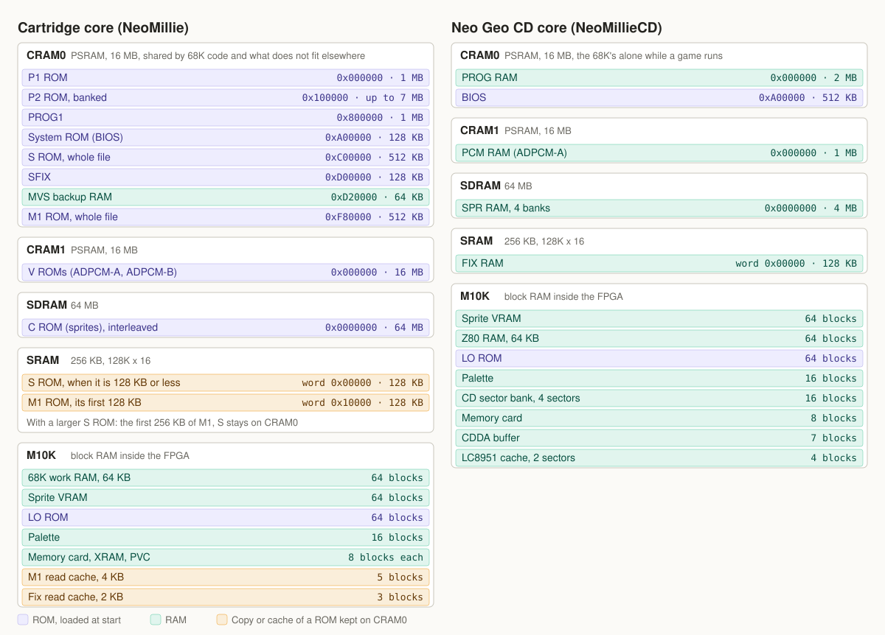
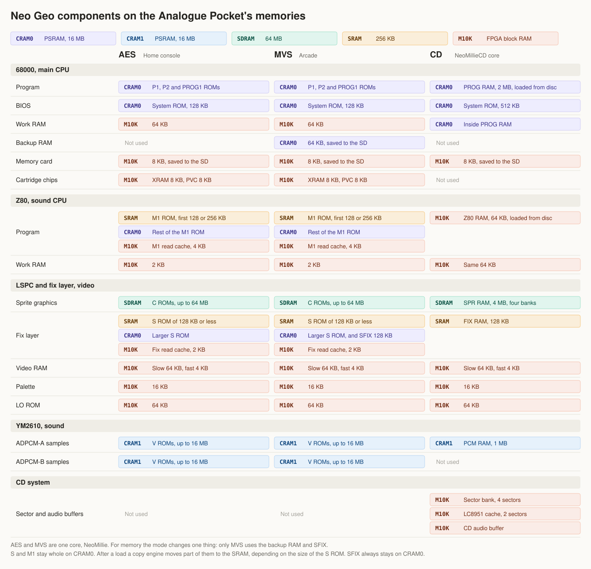

# NeoMillie

NeoMillie is an FPGA core for the Analogue Pocket that lets you play Neo Geo games. It is ported from the current Neo Geo
RTL of the MiSTer project, with a new hardware layer for the Pocket. It comes as two cores: NeoMillie plays cartridge games
as an AES console or an MVS arcade board, and NeoMillieCD plays Neo Geo CD discs.

| Core | What it runs |
|---|---|
| `uniplexed.NeoMillie` | Cartridge games, as a home console (AES) or an arcade board (MVS) |
| `uniplexed.NeoMillieCD` | Neo Geo CD discs, as the first console at single speed or as a CDZ at double speed |

The user manual explains every setting: [English](docs/manual.md), [Español](docs/manual.es.md), [Français](docs/manual.fr.md), [Deutsch](docs/manual.de.md), [Italiano](docs/manual.it.md), [日本語](docs/manual.ja.md).

No BIOS, ROMs or discs are included, and none will be. You need your own. The cores are tested on one Pocket, so reports
are welcome in the issues: say which core, version, BIOS, game and settings.

## What is new in 0.6.0

From this version the two cores share one version number and one release.

### In both cores

| New | What it does |
|---|---|
| 68K Clock | Runs the console's main processor at 12 MHz as the original, or at 16 or 24 MHz. Scenes that slow down on a real console slow down less |
| L/R Buttons | L and R press A+B and C+D, and either one can press A+B+C instead |
| Screen X Position, Screen Y Position | Move the picture up to 32 pixels sideways and 16 lines up or down |
| Stereo Mix | Blends the left and right channels by 25%, 50% or all the way to mono |
| Mute | Silences any of the sound chip's sources: FM, the two kinds of samples and the square wave channels |
| ADPCM-A Channel | Mutes one of the six sample channels, or plays one alone |
| Sound chip | jotego's current YM2610: corrected CSM timing, timer flags and SSG-EG release |
| Menu | The items come in the same order on both cores: system, video, audio, controls |
| Manual | A user manual in English, Spanish, French, German, Italian and Japanese, with a picture of each menu |

### In the cartridge core

| New | What it does |
|---|---|
| MVS DIP | The arcade board's switches: the settings menu, free play and freeze |
| Region | Japan, USA or Europe, through the UniBIOS |
| Memory Card Unplugged | Makes the console see no memory card |
| Games with the SMA chip | A timing fix in the chip's bank switch, which The King of Fighters '99, Garou, Metal Slug 3 and The King of Fighters 2000 use. Metal Slug 3 was played on a Pocket with it |
| Load Game | The entry that picks a game now has that name in the Pocket's menu, where it read Load Game JSON Setup |

### In the CD core

| New | What it does |
|---|---|
| CD Turbo 4x (beta) | Reads the disc's data at four times single speed, with CD/CDZ on or off. The disc's music still plays at normal speed |
| Read ahead | The core keeps five sectors read ahead of the drive, in a six-sector buffer, so a slow read of the SD card is felt less often |
| PAL Output | The 50 Hz picture, which only the cartridge core had |
| Sample uploads | A game that copies sounds to the sample memory with the screen off, as Fatal Fury 3 does after "Fight", now takes the time the console's own processor would: 47 frames at 12 MHz, measured on a Pocket, where 0.5.3 took 51 |

Seven loads of The King of Fighters '99 added up, timed by the core on one Pocket:

| CD/CDZ | CD Turbo 4x | 68K Clock | Seven loads |
|---|---|---|---|
| Off | Off | 12 MHz | 66.3 s |
| On | Off | 12 MHz | 38.4 s |
| On | On | 12 MHz | 27.8 s |
| On | On | 24 MHz | 23.6 s |

### Disc converter

The NeoMillieCD Converter turns a disc kept in another form into the one CUE and one BIN the core reads. Besides the
Python script, it now has a window, built for Windows x64, macOS on Apple Silicon and Linux x64. It reads a CUE with BIN, ISO, WAV,
big-endian or compressed audio, and CloneCD, Alcohol 120%, Nero, DiscJuggler and CHD images, one disc or a whole folder at
a time. A failed or cancelled disc leaves nothing behind, and a disc already converted is skipped unless you ask to
overwrite it.

The window programs are self-contained PyInstaller builds: each carries its own Python, the Tcl/Tk toolkit for the
window and the libraries they use, so nothing has to be installed, which makes each zip 10 to 25 MB. Their licences come
in each zip, in `THIRD-PARTY-LICENSES.txt`.

### Earlier versions

- NeoMillieCD 0.5.3 stopped holding a sector back while the decoder's interrupt was masked, which a real console does not
  do. The 68000's work RAM starts as 0xAA, as on MiSTer, and the memory card is written on Reset Core as well as on Quit.
- NeoMillieCD 0.5.2 fixed memory card saves, which 0.5.0 and 0.5.1 did not write to the SD card. Saves made on those two
  versions cannot be recovered.
- NeoMillieCD 0.5.1 brought the two automatic modes: CD/CDZ picks the console and its speed, and the UniBIOS follows.
- NeoMillie 0.5.1 gave the cartridge core a new memory layout. On Metal Slug X the 68000 loses 0.000% of its clocks waiting
  for memory. Saves are written on Reset Core as well as on Quit.

## Installing

Download the two core zips, `uniplexed.NeoMillie_<version>.zip` and `uniplexed.NeoMillieCD_<version>.zip`, from
[Releases](https://github.com/uniplexed/neomillie/releases) and unzip each to the root of the SD card, merging folders.
Then add your own files.

Cartridges, in `Assets/ng/common/`: `uni-bios_4_0.rom`, `000-lo.lo`, `sfix.sfix`, and one folder per game in the Darksoft
layout. ROMs and BIOS you already use with the Neo Geo Overdrive core work as they are. On the Pocket open openFPGA, then
Neo Geo, and pick a game.

Discs, in `Assets/ngcd/common/`: `uni-bioscd.rom` (the UniBIOS CD, 524,288 bytes), `000-lo.lo`, and one folder per disc
with its `.cue` and `.bin`. On the Pocket open openFPGA, then Neo Geo CD, then NeoMillieCD, and pick the `.cue` on the Disc
entry of Core Settings.

The [manual](docs/manual.md#what-you-need) lists each file. For discs kept in other formats, use the NeoMillieCD
Converter, whose zips are attached to the same release; the [manual](docs/manual.md#disc-images) explains how.

## What has been tested

All on one Pocket. "Build" is the version a row was run on.

### Discs

All with `uni-bioscd.rom`.

| Disc | Setting | Result | Build |
|---|---|---|---|
| The King of Fighters '95 | CD/CDZ on | Plays with music | 0.4.1 |
| The King of Fighters '97 | CD/CDZ on | A fight reached, music fine | 0.5.1 |
| The King of Fighters '97 | CD/CDZ off | A fight reached | 0.5.1 |
| The King of Fighters '98 | CD/CDZ on | Plays, sounds fine | 0.5.1 |
| The King of Fighters '99 | CD/CDZ on and off, CD Turbo 4x on and off, 12, 16 and 24 MHz | Plays in every combination tried | 0.6.0 test build |
| Metal Slug | CD/CDZ off | Works | 0.4.0 |
| Metal Slug 2 | CD/CDZ on | Plays, sounds fine. Slower under heavy load than on the cartridge core | 0.5.1 |
| Samurai Shodown RPG | CD/CDZ on and off | Loads on the first Start Game, up to the fight after choosing a character | 0.5.1 |
| Samurai Shodown IV | CD/CDZ on | Plays, sounds fine | 0.5.1 |
| Last Blade 2 | CD/CDZ off | Works | 0.5.0 |
| Art of Fighting | CD/CDZ on | Plays, sounds fine | 0.5.1 |
| Twinkle Star Sprites | CD/CDZ on | Plays, sounds fine | 0.5.1 |
| Aero Fighters 3 | CD/CDZ on | Plays, sounds fine | 0.5.1 |
| Pulstar | CD/CDZ on | Works | 0.5.1 |
| Fatal Fury 3 | CD/CDZ on, CD Turbo 4x on, 12 and 24 MHz | Works. Its black screens after "Fight" are the game's own, as the [manual](docs/manual.md#things-a-game-does-that-look-like-faults) explains | 0.6.0 test build |

Metal Slug and Metal Slug 2 feel slower on CD than on the cartridge core, and their music and sound differ slightly.

### Cartridge games

Metal Slug (all of level 1), Metal Slug 3 (memory card save and read-back after a power cycle, in MVS and AES modes), Metal
Slug X (first mission), The King of Fighters '98, The King of Fighters 2003, Garou, SVC Chaos, Samurai Shodown V (one
fight), Samurai Shodown V Special (two fights), The Super Spy and Art of Fighting (jukebox with stereo). Also changing
AES/MVS both ways with a game running, PAL on and off, the second player's coin and Reset Core.

On a test build of 0.6.0, with the 68K Clock at 24 MHz: Metal Slug 2, Metal Slug 3, Metal Slug X, The King of Fighters
'94, Fatal Fury 3 and Samurai Shodown V Special, with no fault in the picture reported.

Every run is in [docs/hw-tests.md](docs/hw-tests.md), the project's log of hardware tests.

### BIOS for the CD core

| File | State |
|---|---|
| `uni-bioscd.rom` | The supported one. Every test above |
| `top-sp1.bin` | Can be picked in the menu. Works with CD/CDZ off. With CD/CDZ on it sees the tray as open |
| `front-sp1.bin` | Can be picked in the menu. Loads Metal Slug |
| `neocd.bin` | Boots, then stops at its disc protection check on protected discs: the drive does not answer the command that check needs |

## Known issues and limits

- CD Turbo 4x is in beta and has been tested on a few discs. It copies no real drive, so unlike the two real
  speeds it waits for the program: a sector is held back while the decoder's interrupt is masked (50 ms at most) and, after the unmask, until
  the BIOS has read its count of sectors left. A program that keeps the interrupt open from one sector to the next gets
  them at 2x: Samurai Shodown RPG builds its file list that way, and at 4x it lost names and loaded from the wrong place.
- A read of the SD card can take around 450 ms. It slows a load, and in simulation it leaves a silent gap in the disc's
  music. The console does not pause for it.
- The CD core reports no disc for a CUE of more than 9,408 bytes, a CUE with a second `FILE`, a `WAVE` file or a
  `MODE1/2048` track, an ISO of 2,048-byte sectors, and a BIN that is not beside its CUE. The disc converter attached to
  each release converts those.
- A `PREGAP` before an audio track that follows another audio track plays the next track's first seconds early, as MiSTer
  does with one BIN.
- Not in the CD core: CHD files read directly, subcode, save states, cheats, and any backup memory beyond the 8 KB card.
- Not in the cartridge core: a choice of BIOS from the menu, multitap, spinner and mouse. Its real-time clock was not
  checked.
- Saves from the Neo Geo Overdrive core do not load here, and there is no converter.
- The cartridge core's game list comes from MiSTer's `romsets.xml`. Only the games named above were run on a Pocket.

## How it is built

[docs/memory.md](docs/memory.md) has the addresses, how each chip is shared, the timing budgets and the saves.
[docs/architecture.md](docs/architecture.md) shows the parts of each core and how they work together.

## Artwork

This is NeoMillieCD's banner on the Pocket, with Millie, the logo. NeoMillie ships no banner, because every Neo Geo core
shares the `ng` platform and its image comes from the openFPGA library.

## Supporting the project

NeoMillie is free and will stay free. If it is useful to you, a donation helps pay for the test hardware and the time each
release takes.

## Building from source

    git clone --recurse-submodules https://github.com/uniplexed/neomillie

Simulation, with Verilator from OSS CAD Suite installed under the git-ignored `tools/oss-cad-suite/`:

    python tools/sim.py <bench>        # runs sim/<bench>/tb_*.sv, prints PASS or FAIL

Quartus build, with Quartus Prime Lite 25.1 and a check of the logic and memory budget, then the SD card package:

    python tools/build.py neogeo       # or neogeocd
    python tools/package.py neogeo <version>

## License

GPL-3.0-or-later (see [`LICENSE`](LICENSE)), except where a file's header says otherwise: the CD drive files ported from
MiSTer's `megacdd.cpp` are GPL-3.0-only, which makes the CD core GPL-3.0-only as a whole, and `rtl/top/core_top.v` holds
a part of Analogue's core template under Analogue's EULA.

Neo Geo is a trademark of SNK. This project is not affiliated with or endorsed by SNK, Analogue or the authors of
UniBIOS.

## Credits

Furrtek (Neo Geo core); srg320, Sorgelig, MiSTer-devel, paulb-nl and zakk4223 (MiSTer port, CD subsystem, the CD drive
model, the game list's data); terminator2k2 and Timothee Groleau (the game JSON set for the Overdrive, source of the V2
masks); jotego (jt12, jt49); Jorge Cwik (fx68k); Daniel Wallner (T80); Mazamars312 (Neo Geo Overdrive for Pocket, the
reference for the Pocket memory and loader design); neutralinsomniac (Pocket Mega CD, design reference only); Analogue
(APF framework, under Analogue's own terms). Details and licences are in
[`THIRD_PARTY_NOTICES.md`](THIRD_PARTY_NOTICES.md).

Developed with [Claude Code](https://claude.com/claude-code).
