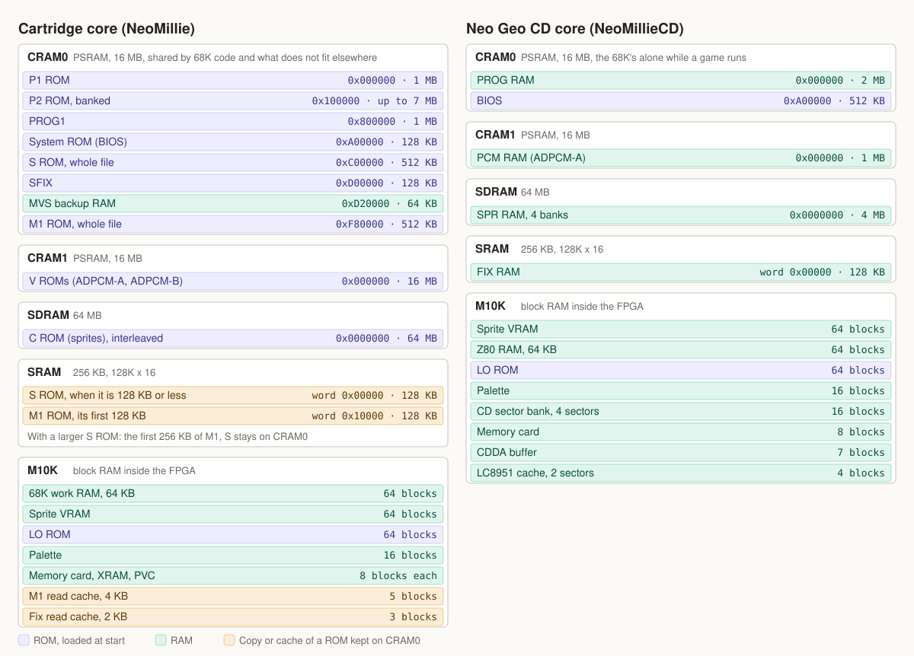
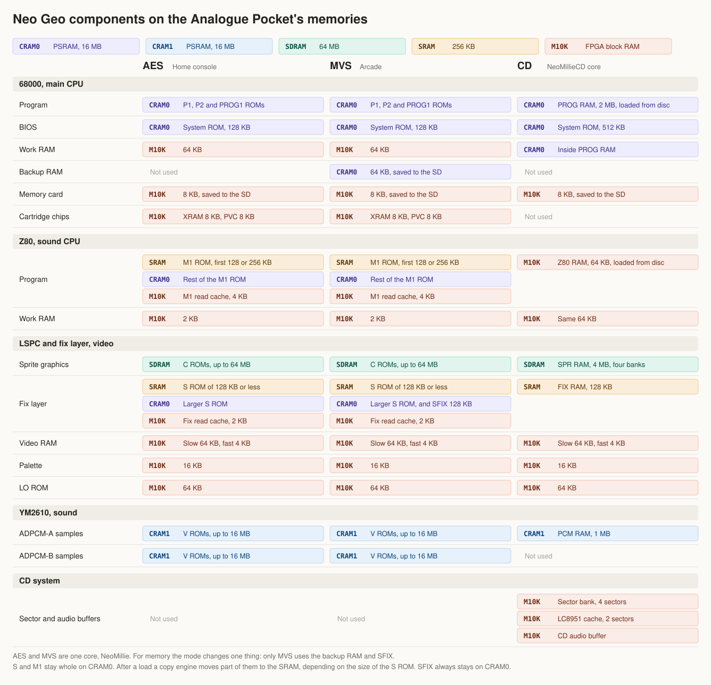

# NeoMillie

Neo Geo (AES/MVS) and Neo Geo CD cores for the Analogue Pocket, built from the current MiSTer Neo Geo RTL plus a new
Pocket hardware layer.

| Core | What it runs | State |
|---|---|---|
| `uniplexed.NeoMillie` | MVS and AES cartridge games | Works on the games tried |
| `uniplexed.NeoMillieCD` | Neo Geo CD discs, with two automatic modes: CD at 1x and CDZ at 2x | Works on the discs below |

**New in NeoMillie 0.5.1: a new memory layout for the cartridge core.** The 68000 loses 0.000% of its
clocks waiting for the ROM memory on Metal Slug X. Saves are written on Reset Core as well as on Quit. Millie's icon is no longer
inverted on the Pocket's menu.

**New in NeoMillieCD 0.5.3: closer to the real console.** A new sector is no longer held back for up to 50 ms while the decoder's
interrupt is masked, which real hardware does not do. The 68000's work RAM starts as 0xAA, as on MiSTer. The memory card is
written on Reset Core as well as on Quit, and the Platform banner is new.

**New in NeoMillieCD 0.5.2: memory card saves reach the SD card.** On 0.5.0 and 0.5.1 a game saved to the card and could
load it until you left the core, but the file was not written on Quit, so the save was lost. Please update. Saves made on
those versions cannot be recovered.

**Since NeoMillieCD 0.5.1: two automatic modes.** Choose CD at 1x or CDZ at 2x with the CD/CDZ setting and the core sets up
the UniBIOS by itself, with nothing to change in its menu. Samurai Shodown RPG now loads on its first Start Game in both
modes, The King of Fighters '97 plays in both, and The King of Fighters '95 plays in CDZ mode with its CD audio.

Tested on one Pocket. Reports are welcome in the issues: say which core, version, BIOS, game and setting.

No BIOS, ROMs or discs are included, and none will be. You need your own.

## Supporting the project

NeoMillie is free and will stay free. If it is useful to you, a donation helps pay for the test hardware and the time
that goes into each release.

## Installing

Download the zips from [Releases](https://github.com/uniplexed/neomillie/releases) and unzip each to the root of the
SD card, merging folders. The packages also add the `ng` and `ngcd` platform entries, with their images.

### Neo Geo CD

1. In `Assets/ngcd/common/` put `000-lo.lo` and `uni-bioscd.rom`, the UniBIOS CD, exactly 524,288 bytes. The core
   loads that file by name.
2. Put each disc in its own folder there, with its BIN beside its CUE, for example
   `Assets/ngcd/common/Metal Slug/Metal Slug.cue` and `Metal Slug.bin`.
3. On the Pocket: **openFPGA**, **Neo Geo CD**, **NeoMillieCD**: the BIOS loads. In the Pocket's menu, pick the `.cue`
   on the **Disc** slot.

### Neo Geo cartridges

1. In `Assets/ng/common/` put `uni-bios_4_0.rom`, `000-lo.lo` and `sfix.sfix`, and one folder per game in the Darksoft
   layout (`srom`, `prom`, `crom0`, `m1rom`, `vroma0`, and `prom1` if the game has one). The folder name is the
   `data_path` of the game's JSON file. ROMs and BIOS you already use with the Neo Geo Overdrive core work as they are.
2. On the Pocket: **openFPGA**, **Neo Geo**, then pick a game from the list.

## The CD core

The memory layout of this core is in [Memory layout](#memory-layout).

### Speed and the CD/CDZ setting

| CD/CDZ | Reads the disc at | Time per sector |
|---|---|---|
| Off, the default | 1x, 150 KB/s | 13.33 ms |
| On | 2x, 300 KB/s | 6.67 ms |

Changing the setting restarts the core and returns to the BIOS, so unsaved progress is lost. The disc stays mounted.
The Pocket remembers the setting.

The setting also decides which console the UniBIOS runs as: a top loader with CD/CDZ off and a CDZ with it on. There is nothing
to set. The SYSTEM item in the UniBIOS's own menu has no effect in this core, whatever it shows or has saved.

### Tested discs

All with `uni-bioscd.rom`, on a Pocket. "Build" is the version the row was run on.

| Disc | Setting | Result | Build |
|---|---|---|---|
| The King of Fighters '95 | CD/CDZ on, 2x | Plays with music | 0.4.1 |
| The King of Fighters '97 | CD/CDZ on, 2x | A fight reached, music fine | 0.5.1 |
| The King of Fighters '97 | CD/CDZ off, 1x | A fight reached | 0.5.1 |
| The King of Fighters '99 | CD/CDZ on, 2x | A fight finished, no cuts in the music heard | 0.4.0 |
| Metal Slug | CD/CDZ off, 1x | Works | 0.4.0 |
| Samurai Shodown RPG | CD/CDZ on, 2x | Loads on the first Start Game, up to the fight after choosing a character | 0.5.1 |
| Samurai Shodown RPG | CD/CDZ off, 1x | Loads on the first Start Game, up to the fight after choosing a character | 0.5.1 |
| Last Blade 2 | CD/CDZ off, 1x | Works | 0.5.0 |
| The King of Fighters '98 | CD/CDZ on, 2x | Plays, sounds fine | 0.5.1 |
| Art of Fighting | CD/CDZ on, 2x | Plays, sounds fine | 0.5.1 |
| Samurai Shodown IV | CD/CDZ on, 2x | Plays, sounds fine | 0.5.1 |
| Twinkle Star Sprites | CD/CDZ on, 2x | Plays, sounds fine | 0.5.1 |
| Metal Slug 2 | CD/CDZ on, 2x | Plays, sounds fine. Slower under heavy load than on the cartridge core | 0.5.1 |
| Aero Fighters 3 | CD/CDZ on, 2x | Plays, sounds fine | 0.5.1 |
| Pulstar | CD/CDZ on, 2x | Works | 0.5.1 |
| Fatal Fury 3 | CD/CDZ on, 2x | Works almost perfectly, with a few black frames | 0.5.1 |

Metal Slug and Metal Slug 2 feel slower on CD than on the cartridge core, and the music and sound differ slightly. Every run is in
[`docs/hw-tests.md`](docs/hw-tests.md), a chronological log of the project's hardware tests.

### BIOS

| File | State |
|---|---|
| `uni-bioscd.rom` | The supported one. All the tests above |
| `top-sp1.bin` | Can be picked in the menu. Works at 1x with CD/CDZ off. With CD/CDZ on it sees the tray as open |
| `front-sp1.bin` | Can be picked in the menu. Loads Metal Slug |
| `neocd.bin` | Boots, then stops at its disc protection check on protected discs, as the drive does not answer the TOC sub-command that check needs |

### Known issues

- **Brief music cuts** were heard on a debug build, which also writes a counter file to the SD card every 7 seconds.
- **Slow SD reads:** a read can take around 450 ms. This slows loading, and in simulation it leaves a silent gap in CD
  audio. The emulated system does not pause for it.

### Disc images

The core reads MODE1/2352 `.cue`/`.bin` only: one `.cue` naming one BIN, with `MODE1/2352` and `AUDIO` tracks, or a raw
`.bin` of one data track. Sets of ISO and WAV files, one file per track, and CHD files need converting first with
`cd_convert.py`, which is attached to each [release](https://github.com/uniplexed/neomillie/releases) and is in `tools/`.
It is one script that needs only Python 3.8 or newer:

    python cd_convert.py DISC.cue OUTDIR [--name NAME]
    python cd_convert.py DISC.chd OUTDIR [--name NAME]

It takes a CUE of MODE1/2048 or MODE1/2352 data tracks and AUDIO tracks, in BINARY or WAVE files, or a CHD. It only reads
them, and writes `NAME.bin` and `NAME.cue` to `OUTDIR/NAME/`. Copy that folder to `Assets/ngcd/common/`. It refuses an
output that would overwrite its source.

A CHD also needs `chdman`, which comes with [MAME](https://www.mamedev.org/), on the PATH or beside the script. The CHD
path uses chdman 0.289: Metal Slug and The King of Fighters '95, turned into CHDs and back, gave the same BIN
byte for byte. Metal Slug's CUE was also the same. A CHD does not keep the indexes above 01 of a data track, so KOF '95's
CUE loses them.

### Slots and menu

| Slot | Required | What it takes |
|---|---|---|
| BIOS | yes | `uni-bioscd.rom`, loaded by name; another `.rom`, `.bin` or `.sp1` of exactly 524,288 bytes can be picked |
| LO | yes | `000-lo.lo` |
| Disc | no | Picked by you: a `.cue`, or a raw `.bin` |
| Disc data | no | Not yours to pick: the core opens the CUE's BIN here |
| Memory Card | no | Up to 8 KB, `Saves/ngcd/common/uni-bioscd.sav`, written on Quit and on Reset Core. One card, whichever BIOS is picked |

Menu: Reset Core, CD/CDZ, Region (US, EU, JP, AS), 304 or 320 wide, and four aspect ratios for the scaler.

### Limits

- A CUE of more than 9,408 bytes is reported as no disc. So is a CUE with a second `FILE`, a `WAVE` file or a MODE1/2048
  track, an ISO of 2,048-byte sectors, and a BIN that is not there.
- BINs go under `Assets/ngcd/`. The core opens the name in the CUE from the CUE's own folder.
- A `PREGAP` before an audio track that follows an audio track plays the next track's first seconds before that track
  starts, as MiSTer does with one BIN. `cd_convert.py` keeps a `PREGAP` as it finds it.
- No CHD, no subcode, no save states, no cheats, and no backup RAM cartridge beyond the 8 KB card.

## The cartridge core

The memory layout of this core is in [Memory layout](#memory-layout).

Slots: `Game JSON Setup` is the pick from the list, and the game's JSON file fills SROM, PROG, PROG1, CROM, MROM and
VROM. BIOS, LO and SFIX are the fixed files above. Saves: `Memory Card` and `Backup Ram` (`backup.bak`).

Menu: Reset Core, AES/MVS (on is MVS), PAL output, 304 or 320 wide, and four aspect ratios for the scaler.

Tested on one Pocket and working: Metal Slug (all of level 1), Metal Slug 3 (memory card save and read-back after a power
cycle, in MVS and AES modes), Metal Slug X (first mission), KOF '98, KOF 2003, Garou, SVC Chaos, Samurai Shodown V (one
fight), Samurai Shodown V Special (two fights), The Super Spy, Art of Fighting 1 (jukebox with stereo), changing AES/MVS
both ways with a game running, PAL on and off, the P2 coin and Reset Core. On Metal Slug X, first mission, one play, the 68000
loses 0.000% of its clocks waiting for the ROM memory.

Limits:

- The real-time clock (date, time, weekday) was not checked.
- Not in this core: screen X/Y position, DIP switch settings, channel mutes, BIOS choice, multitap, spinner and
  mouse, combo buttons, CPU overclock.
- The game list is generated from MiSTer's `romsets.xml`, with the V2 masks of the Overdrive's JSON set. The games named
  above are the ones run on a Pocket.
- Saves from the Overdrive core do not load in this one. Its `backup.bak` has the bytes of each 32-bit word reversed,
  its `.sav` has the two halves of each word swapped, and the folder under `Saves/ng/` differs. There is no converter.

## Memory layout

[docs/memory.md](docs/memory.md) has the addresses, the arbitration of each chip, the timing budgets including `RD_WAIT`, the saves and how to
measure and change them.

The same layout seen from the other side: for each Neo Geo component, the memory that holds it in each mode.

## Artwork

The Platform banner of NeoMillieCD, with Millie, the logo. NeoMillie ships no banner: the `ng` Platform is shared by every Neo Geo
core, and its image is the library's.

## Building from source

    git clone --recurse-submodules https://github.com/uniplexed/neomillie

Simulation (Verilator from OSS CAD Suite, installed under the git-ignored `tools/oss-cad-suite/`):

    python tools/sim.py <bench>        # runs sim/<bench>/tb_*.sv, prints PASS/FAIL

Quartus build (Quartus Prime Lite 25.1) with the ALM and M10K budget check, then the SD card package:

    python tools/build.py neogeo       # or neogeocd
    python tools/package.py neogeo <version>

`neogeocd_debug` builds the CD core's debug version: it keeps CD Speed and Lid open in the menu, and writes counters to
`wait.sav`, which `tools/check_wait_save.py` reads.

Fit on the 5CEBA4F23C8, of 18,480 ALMs and 308 M10K: NeoMillie 0.5.1 takes 8,994 ALMs and 280 M10K and NeoMillieCD 0.5.3
11,527 ALMs and 281 M10K, with no negative slack in either.

## License

GPL-3.0-or-later (see [`LICENSE`](LICENSE)), except where a file's header says otherwise: the CD drive files ported from
MiSTer's `megacdd.cpp` are GPL-3.0-only, which makes the CD core GPL-3.0-only as a whole, and `rtl/top/core_top.v` holds
a part of Analogue's core template under Analogue's EULA.

Neo Geo is a trademark of SNK. This project is not affiliated with or endorsed by SNK, Analogue or the authors of
UniBIOS.

## Credits

Furrtek (Neo Geo core); srg320, Sorgelig, MiSTer-devel, paulb-nl and zakk4223 (MiSTer port, CD subsystem, the CD drive
model, the game list's data); terminator2k2 and Timothee Groleau (the game JSON set for the Overdrive, source of the V2
masks); jotego (jt12, jt49); Jorge Cwik (fx68k); Daniel Wallner (T80); Mazamars312 (Neo Geo Overdrive for Pocket, the
reference for the Pocket memory and loader design); neutralinsomniac (Pocket Mega CD, design reference only); Analogue
(APF framework, under Analogue's own terms). Details and licences are in
[`THIRD_PARTY_NOTICES.md`](THIRD_PARTY_NOTICES.md).

Developed with [Claude Code](https://claude.com/claude-code).
