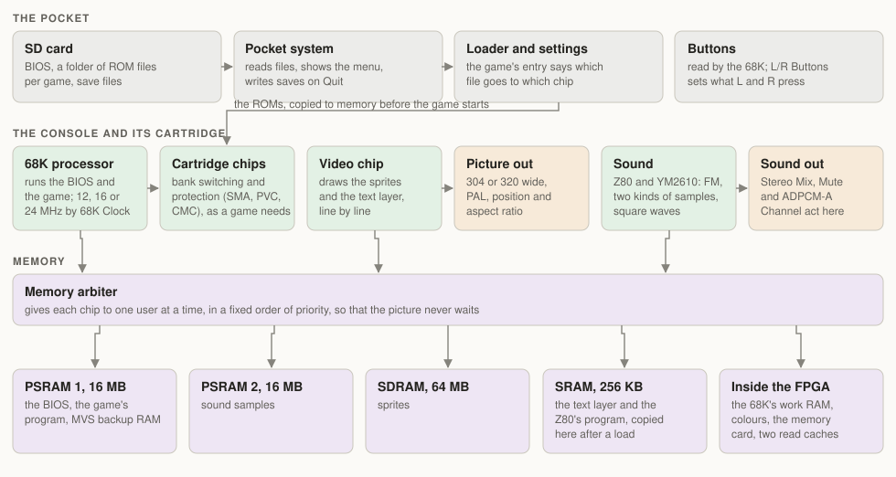
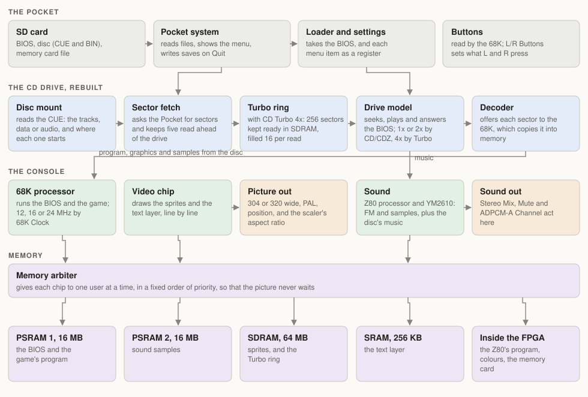

# How the cores are built

NeoMillie is an FPGA core for the Analogue Pocket that plays Neo Geo games, ported from the MiSTer project's Neo Geo RTL.
NeoMillie runs cartridge games as an AES console or an MVS arcade board, and NeoMillieCD runs Neo Geo CD discs. The
console's own chips are MiSTer's RTL, compiled from the `upstream/NeoGeo_MiSTer` submodule. This project adds the layer
around them: how files reach the core, where each ROM and RAM lives on the Pocket's memory chips, and a CD drive rebuilt
on top of the Pocket's file reads.

The user manual is in [manual.md](manual.md). The memory map, with addresses and timing, is in [memory.md](memory.md).

## The cartridge core

The Pocket's system reads the files from the SD card and hands them to the loader. The entry you pick in the game list is
a small JSON file: it names the game's ROM files and sets the chips that game's cartridge had, such as its bank switching
or its protection. The loader copies each ROM to the memory chip that suits it and the console starts.

While the game runs, three parts of the console read memory all the time: the 68K its program, the video chip its sprites
and text, and the sound side its samples and the Z80's program. One arbiter decides who gets each chip. The video chip
goes first, because a sprite or a text tile that arrives late shows on screen as a wrong pixel. The 68K can wait a cycle,
and the debug build counts how often it does: on Metal Slug X it loses 0.000% of its clocks.

Every menu item is a register the Pocket writes. Most act at once. AES/MVS and 68K Clock restart the console, since a real
one could not change them while running.

## The CD core

The console is the same, without the cartridge. In its place is a CD drive that does not exist: the Pocket has no disc, only
a `.bin` file on the SD card and a way to ask for a piece of it.

The disc mount reads the `.cue` and builds the table of tracks. The drive model answers the BIOS as the drive's own
processor did: it seeks, plays, reports its position and delivers 75 sectors a second at single speed, 150 at double. The
sector fetch asks the Pocket for the sectors the drive will need and stays five ahead of it, because one read of the SD
card can take longer than a sector lasts. With CD Turbo 4x a second path takes over. Each read brings 16 sectors into a
ring of 256 kept in SDRAM, and the drive delivers up to 300 sectors a second, paced to the program: a sector waits while
the decoder's interrupt is masked, and comes at the 2x pace while a program keeps it open.

A data sector goes to the decoder, which the BIOS reads to copy the program, the graphics and the samples to their
memories. An audio sector goes straight to the sound output as the disc's music.

The memory holds different things than on a cartridge. The program lives in RAM the BIOS fills from the disc. So do the
sprites, the text layer and the samples, which is why a game can swap them while it runs.

## Where to look in the source

| Part | Files |
|---|---|
| The console's chips | `upstream/NeoGeo_MiSTer/rtl/`, and `rtl/top/neogeo_pocket.sv`, the Pocket's version of MiSTer's top level |
| Loader and settings | `rtl/pocket/apf_loader.sv`, `rtl/pocket/apf_regs.svh` |
| Memory arbiter and chip controllers | `rtl/pocket/pocket_mem_mux.sv`, `cram_ctrl.sv`, `sdram_ctrl.sv`, `sram_port.sv` |
| Picture out | `rtl/pocket/video_out.sv` |
| CD drive | `rtl/cd/`: `cd_mount.sv`, `cd_host.sv`, `cd_fetch.sv`, `cd_ring.sv`, `cd_ring_wr.sv`, `cdd_drive.sv`, `lc8951.v`, `cd.sv` |
| Menus and slots | `pocket/neogeo/` and `pocket/neogeocd/` |
| Test benches | `sim/`, run with `python tools/sim.py <bench>` |

The diagrams on this page are drawn by `tools/make_diagrams.py`, and the menu pictures of the manual by
`tools/make_menu_images.py` from the cores' own menu files.
