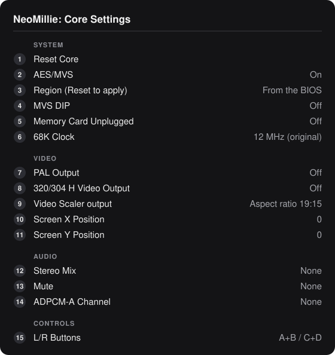

# NeoMillie Benutzerhandbuch

[English](manual.md) | [Español](manual.es.md) | [Français](manual.fr.md) | [Deutsch](manual.de.md) | [Italiano](manual.it.md) | [日本語](manual.ja.md)

Für NeoMillie und NeoMillieCD 0.6.0 auf dem Analogue Pocket.

NeoMillie ist ein FPGA-Core für den Analogue Pocket, portiert vom Neo-Geo-RTL des MiSTer-Projekts. Damit spielst du
Neo-Geo-Spiele: Mit NeoMillie laufen Cartridge-Spiele wahlweise als Heimkonsole (AES) oder als Arcade-Platine (MVS), mit
NeoMillieCD Discs des Neo Geo CD. Beide sind openFPGA-Cores. Keiner von beiden enthält ein BIOS, ein Spiel oder eine
Disc, die bringst du selbst mit.

Die Namen der Einstellungen stehen hier auf Englisch, so wie der Pocket sie anzeigt.

## Inhalt

1. [Was du brauchst](#was-du-brauchst)
2. [Ein Spiel starten](#ein-spiel-starten)
3. [Steuerung](#steuerung)
4. [Das Menü des Cartridge-Cores](#das-menü-des-cartridge-cores)
5. [Das Menü des CD-Cores](#das-menü-des-cd-cores)
6. [Disc-Images](#disc-images)
7. [Ladezeiten und Geschwindigkeit](#ladezeiten-und-geschwindigkeit)
8. [Spielstände](#spielstände)
9. [Dinge, die ein Spiel tut und die wie Fehler aussehen](#dinge-die-ein-spiel-tut-und-die-wie-fehler-aussehen)
10. [Wenn etwas schiefgeht](#wenn-etwas-schiefgeht)

## Was du brauchst

Lade die beiden Zip-Dateien von [Releases](https://github.com/uniplexed/neomillie/releases) herunter und entpacke beide
ins Hauptverzeichnis der SD-Karte. Gleichnamige Ordner führst du dabei zusammen. Danach legst du deine eigenen Dateien
dazu.

Für Cartridge-Spiele, in `Assets/ng/common/`:

| Datei | Was es ist |
|---|---|
| `uni-bios_4_0.rom` | Das UniBIOS 4.0 |
| `000-lo.lo` | Das LO-ROM |
| `sfix.sfix` | Die Textebene des BIOS |
| Ein Ordner pro Spiel | Die ROMs des Spiels im Darksoft-Aufbau: `srom`, `prom`, `crom0`, `m1rom`, `vroma0` und `prom1`, wenn das Spiel eines hat |

Jeder Spielordner muss so heißen, wie es sein Eintrag in der Liste des Cores erwartet. Wenn du schon den
Neo-Geo-Overdrive-Core benutzt, kannst du dein BIOS und deine Spielordner unverändert übernehmen.

Für Discs, in `Assets/ngcd/common/`:

| Datei | Was es ist |
|---|---|
| `uni-bioscd.rom` | Das UniBIOS CD, genau 524.288 Bytes groß. Der Core lädt es über seinen Namen |
| `000-lo.lo` | Das LO-ROM |
| Ein Ordner pro Disc | Die `.cue`-Datei der Disc mit der zugehörigen `.bin` daneben, zum Beispiel `Metal Slug/Metal Slug.cue` und `Metal Slug.bin` |

Eine Disc muss aus einer CUE und einer BIN bestehen. Wie du andere Formate umwandelst, steht unter
[Disc-Images](#disc-images).

## Ein Spiel starten

Cartridge-Core: Öffne am Pocket openFPGA, dann Neo Geo, und wähle ein Spiel aus der Liste. Der Core lädt das BIOS und die
ROMs des Spiels und startet es.

CD-Core: Öffne openFPGA, dann Neo Geo CD, dann NeoMillieCD. Der Core lädt das BIOS, und es zeigt seinen eigenen
Bildschirm. Öffne das Pocket-Menü, geh zu Core Settings und wähle beim Eintrag Disc die `.cue`-Datei der Disc. Das BIOS
findet die Disc und startet sie. Für einen Discwechsel wählst du auf dieselbe Weise eine andere `.cue`.

Zum Verlassen eines Cores öffnest du das Pocket-Menü und wählst Quit. Dabei schreibt der Pocket auch deine Spielstände auf
die SD-Karte. Beende den Core deshalb mit Quit, statt den Pocket mitten im Spiel auszuschalten.

## Steuerung

| Pocket | Neo Geo |
|---|---|
| Steuerkreuz | Joystick |
| A, B, X, Y | A, B, C, D |
| Start | Start |
| Select | Select an der Heimkonsole, und ein Münzeinwurf im Arcade-Modus |
| L | A und B zusammen, oder A, B und C zusammen |
| R | C und D zusammen, oder A, B und C zusammen |

Was L und R tun, stellst du unter [L/R Buttons](#lr-buttons) ein. Ein zweiter Controller am Dock ist Spieler 2.

## Das Menü des Cartridge-Cores

Öffne bei laufendem Spiel das Pocket-Menü und geh zu Core Settings. Der Pocket zeigt die Einträge des Cores in dieser
Reihenfolge, und dieser Abschnitt nummeriert sie genauso. Im Pocket ist das eine einzige Liste; die Gruppennamen gibt es
nur in diesem Bild.

Die meisten Einträge wirken sofort. Drei starten das Spiel neu, wenn du sie änderst: Reset Core, AES/MVS und 68K Clock.
Speichere vorher.

Der Pocket merkt sich alle Einträge für das nächste Mal. Nur MVS DIP, Memory Card Unplugged, Mute und ADPCM-A Channel
springen bei jedem Öffnen des Cores auf ihren Standardwert zurück.

### System

1. Reset Core. Startet die Konsole neu. Vorher schreibt der Core die Memory Card auf die SD-Karte, im MVS-Modus auch das
   Backup-RAM, damit bei einem Reset kein Spielstand verloren geht.

2. AES/MVS. Eingeschaltet ist das die Arcade-Platine (MVS), ausgeschaltet die Heimkonsole (AES). Standard ist
   eingeschaltet. Das UniBIOS richtet sich automatisch nach diesem Eintrag, der Eintrag SYSTEM im Menü des UniBIOS hat
   hier also keine Wirkung. Im MVS-Modus wirft Select eine Münze ein, und das Spiel speichert seine Einstellungen und
   Highscores im Backup-RAM. Eine Änderung startet das Spiel neu.

3. Region (Reset to apply). Japan, USA oder Europe, oder From the BIOS: Dann entscheidet die Einstellung im UniBIOS
   selbst. From the BIOS ist der Standardwert. Spiele wählen anhand der Region ihre Sprache, und manche blenden damit Blut
   ein oder aus. Die Konsole liest die Region beim Start, benutze nach einer Änderung also Reset Core. Das funktioniert
   nur mit dem UniBIOS.

4. MVS DIP. Die DIP-Schalter der Arcade-Platine. Settings öffnet das Test- und Einstellungsmenü der Platine, mit Freeplay
   spielst du ohne Münzen, und Freeze hält das Spiel an, solange es eingeschaltet ist. Die Liste bietet auch jedes Paar
   und alle drei zusammen an. Wenn Settings nichts bewirkt, lass es eingeschaltet und benutze Reset Core.

5. Memory Card Unplugged. Die Konsole sieht dann keine Memory Card. Das hilft bei einem Spiel, das bei jedem Start nach
   der Karte fragt, wenn dich das stört.

6. 68K Clock. Der Takt des Hauptprozessors der Konsole: 12 MHz wie beim Original, 16 MHz oder 24 MHz. Ein schnellerer
   Prozessor schafft pro Bild mehr Arbeit, deshalb werden Szenen, die auf einer echten Konsole einbrechen, weniger
   langsam. Das Spiel selbst läuft nicht schneller, denn sein Tempo richtet sich nach den 60 Bildern pro Sekunde des
   Bildschirms. Ton und Bildtiming ändern sich nicht. Eine Änderung startet das Spiel neu.

### Video

7. PAL Output. Die Konsole gibt ihr Bild mit 50 Bildern pro Sekunde nach PAL-Norm aus, wie eine europäische Konsole.
   Ausgeschaltet, der Standard, sind es 60. Eingeschaltet laufen Spiele etwas langsamer. Das Bild behält seine 224 Zeilen.

8. 320/304 H Video Output. Eingeschaltet siehst du alle 320 Spalten, die die Konsole zeichnet. Ausgeschaltet, der
   Standard, siehst du die mittleren 304. Damit verschwinden die Randspalten, in denen viele Spiele Grafikmüll
   hinterlassen.

9. Video Scaler output. Das Seitenverhältnis des Bildes auf dem Bildschirm des Pocket: 19:15, 160:144, 4:3 oder 16:9.
   Standard ist 19:15. 16:9 ist für einen Fernseher am Dock gedacht.

10. Screen X Position. Verschiebt das Bild nach links oder rechts, von -32 bis 32 Pixel. Positive Werte verschieben es
    nach rechts.

11. Screen Y Position. Verschiebt das Bild nach oben oder unten, von -16 bis 16 Zeilen. Positive Werte verschieben es
    nach unten.

### Audio

12. Stereo Mix. Mischt den linken und den rechten Kanal: None, 25%, 50% oder 100%, was Mono entspricht. Manche Spiele
    legen einen Klang ganz auf eine Seite, was über Kopfhörer anstrengend ist. Etwas Mischung mildert das.

13. Mute. Schaltet eine oder mehrere der vier Quellen des Soundchips stumm: FM-Musik, die kurzen Samples (A), die langen
    Samples (B) und die Rechteckkanäle (PSG). Die Liste enthält jede Kombination.

14. ADPCM-A Channel. Die kurzen Samples laufen auf sechs Kanälen. Dieser Eintrag schaltet einen davon stumm oder lässt
    einen allein spielen (Solo).

Mit Mute und ADPCM-A Channel kannst du hören, wie ein Spiel seinen Sound zusammensetzt. Zum Spielen lässt du beide auf
None.

### Steuerung

15. L/R Buttons. Legt fest, welche Tasten die Schultertasten drücken.

| Einstellung | L | R |
|---|---|---|
| A+B / C+D, der Standardwert | A und B | C und D |
| ABC / C+D | A, B und C | C und D |
| A+B / ABC | A und B | A, B und C |

## Das Menü des CD-Cores

Im CD-Core fehlen AES/MVS, Region (Reset to apply), MVS DIP und Memory Card Unplugged. Dafür hat er ganz oben drei eigene
Einträge. Die übrigen sind dieselben wie im Cartridge-Core und funktionieren genauso.

Reset Core, CD/CDZ, CD Turbo 4x und 68K Clock starten das Spiel neu. Danach startet das BIOS wieder, und die Disc bleibt
eingelegt. Der Pocket merkt sich alles außer Mute und ADPCM-A Channel.

1. Reset Core. Schreibt die Memory Card auf die SD-Karte und startet dann die Konsole neu.

2. CD/CDZ. Legt fest, welche Konsole der Core nachbildet. Ausgeschaltet, der Standard, ist es das erste Neo Geo CD, das
   Discs mit einfacher Geschwindigkeit liest. Eingeschaltet ist es das CDZ, das mit doppelter Geschwindigkeit liest und
   deshalb in etwa der halben Zeit lädt. Das UniBIOS richtet sich automatisch nach diesem Eintrag. Eine Änderung startet
   das Spiel neu.

3. Region. US, EU, JP oder AS (Asia). US ist der Standardwert. Diese Region meldet die Konsole selbst, und Spiele nutzen
   sie wie Region im Cartridge-Core. Benutze nach einer Änderung Reset Core.

4. CD Turbo 4x (beta). Liest die Daten der Disc mit vierfacher Geschwindigkeit, egal ob CD/CDZ ein- oder ausgeschaltet
   ist. Musik von der Disc spielt weiter in normalem Tempo. Getestet ist der Eintrag nur mit dem UniBIOS und mit wenigen
   Discs: Wenn sich ein Spiel damit seltsam verhält, schalte ihn als Erstes aus. Eine Änderung startet das Spiel neu.

5. 68K Clock. Wie im Cartridge-Core. Bei Discs verkürzt er außerdem die Ladezeiten etwas, weil der Prozessor einen Teil
   der Ladearbeit selbst erledigt.

Die Einträge 6 bis 14 sind PAL Output, 320/304 H Video Output, Video Scaler output, Screen X Position, Screen Y Position,
Stereo Mix, Mute, ADPCM-A Channel und L/R Buttons, wie oben beschrieben. Bei Discs gibt es zwei Unterschiede: Stereo Mix
mischt auch die Musik der Disc, und Mute schaltet diese Musik nicht stumm. Die Quelle B von Mute bewirkt nichts, weil das
Neo Geo CD keine langen Samples hat.

## Disc-Images

Der Core liest eine Disc als eine `.cue`, die auf eine einzige `.bin` verweist, mit Spuren vom Typ `MODE1/2352` und
`AUDIO`. Eine rohe `.bin` mit einer einzigen Datenspur geht auch.

Alle anderen Formate wandelst du vorher mit dem NeoMillieCD Converter um, der jedem
[Release](https://github.com/uniplexed/neomillie/releases) beiliegt. Er liest:

- eine `.cue` mit BIN-, ISO- oder WAV-Dateien, eine pro Spur oder gemeinsam genutzt, Big-Endian-Audio (`MOTOROLA`) oder
  Audio als MP3, OGG, FLAC, APE oder Opus;
- CloneCD (`.ccd` mit ihrer `.img`), Alcohol 120% (`.mds` mit ihrer `.mdf`, Version 1), Nero (`.nrg`) und DiscJuggler
  (`.cdi`, Versionen 2, 3 und 3.5);
- CHD (`.chd`).

Er liest deine Dateien, ohne sie zu verändern, und schreibt pro Disc einen Ordner mit einer CUE und einer BIN. Jede Disc
schreibt er zuerst unter einem vorläufigen Namen und benennt sie erst um, wenn sie vollständig ist. Schlägt eine Disc fehl
oder brichst du ab, bleibt deshalb nichts von ihr zurück. Eine Disc, die schon am Ziel liegt, überspringt er, außer du
lässt sie überschreiben. `MODE2`-Spuren und Discs mit mehr als einer Session lehnt er ab; Spiele für das Neo Geo CD
verwenden beides nicht.

### Das Fenster

Lade die Zip-Datei für dein System herunter und entpacke sie:

| System | Datei |
|---|---|
| Windows x64 | `NeoMillieCD-Converter-windows-x64.zip` |
| macOS auf Apple Silicon | `NeoMillieCD-Converter-macos-arm64.zip` |
| Linux x64 | `NeoMillieCD-Converter-linux-x64.zip` |

Jedes Programm ist eigenständig. Es wird mit PyInstaller gebaut und bringt einen eigenen Python-Interpreter mit, das
Tcl/Tk-Toolkit, das das Fenster zeichnet, und die Bibliotheken, die Python verwendet, etwa OpenSSL, zlib, bzip2 und xz.
Das Linux-Programm enthält zusätzlich die Bibliotheken X11, fontconfig und FreeType, die das Fenster braucht. Du musst
nichts installieren, deshalb ist jedes Zip 10 bis 25 MB groß, die Skripte dagegen nur 56 KB. ffmpeg und chdman sind
nicht enthalten, siehe [ffmpeg und chdman](#ffmpeg-und-chdman). Die Lizenzen von allem, was darin steckt, stehen in
`THIRD-PARTY-LICENSES.txt` in jedem Zip.

Die Programme sind nicht signiert. Beim ersten Start fragt Windows SmartScreen nach: Wähle *More info* und dann
*Run anyway*. Unter macOS öffnest du die App einmal, schließt die Meldung, dass sie nicht überprüft werden kann, und
wählst dann in den Systemeinstellungen unter Datenschutz & Sicherheit *Open Anyway*. Für Intel-Macs gibt es keinen Build,
dort nimmst du das Python-Skript weiter unten.

#### Schritt für Schritt

1. Öffne das Programm. Das Fenster ist zu Beginn leer.

   

2. Füge deine Discs hinzu. Mit *Add discs…* wählst du Image-Dateien aus (`.cue`, `.chd`, `.ccd`, `.mds`, `.nrg`,
   `.cdi`), mit *Add folder…* einen Ordner, in dem der Konverter jede Disc findet, auch in den Unterordnern. Jede Disc
   bekommt eine Zeile mit Name, Format und Status. Unter diesem Namen landen Ordner und Dateien der Disc auf der SD-Karte;
   mit einem Doppelklick änderst du ihn. *Remove* nimmt die ausgewählten Zeilen aus der Liste.
3. Wähle mit *Browse…*, wohin die Discs kommen. Ist *SD card layout* eingeschaltet, wählst du das Hauptverzeichnis der
   SD-Karte, und jede Disc landet in `Assets/ngcd/common/`, wo der Core sie sucht. Ist es ausgeschaltet, landen die Discs
   in dem Ordner, den du wählst. Eine Disc, die schon dort liegt, wird übersprungen, außer *Overwrite* ist eingeschaltet.

   

4. Sieh dir die Statusspalte an. Eine Disc mit *needs chdman* oder *needs ffmpeg* wartet auf dieses Programm:
   Installiere es (siehe [ffmpeg und chdman](#ffmpeg-und-chdman)) oder drücke unter *Tools* neben dem Namen des
   Programms auf *Locate…* und wähle es aus.
   Die Disc wechselt dann auf *pending*.

   

5. Drücke *Convert*. Der Balken *Disc* zeigt den Fortschritt der aktuellen Disc, *Total* den der ganzen Liste. *Cancel*
   bricht ab: Von der Disc, die gerade konvertiert wird, bleibt nichts zurück, auch nichts halb Geschriebenes, und die
   schon fertigen Discs bleiben erhalten.

   

6. Wenn jede Zeile *done* zeigt, sind die Discs fertig: ein Ordner pro Disc, jeder mit einer `.cue` und einer `.bin`.
   Stecke die SD-Karte in den Pocket und wähle in den Core Settings des CD-Cores beim Eintrag Disc die `.cue`-Datei der
   Disc. Schlägt eine Disc fehl, steht der Grund in ihrer Zeile; die anderen werden trotzdem konvertiert.

   

Das Fenster merkt sich das Ziel, ob *SD card layout* eingeschaltet ist und wo ffmpeg und `chdman` liegen.

### Das Skript

`NeoMillieCD-Converter-python.zip` enthält denselben Konverter als Python-Skripte, für jedes System mit Python 3.8 oder
neuer:

    python cd_convert.py SOURCE... DEST [--name NAME] [--overwrite]
    python cd_convert_gui.py

SOURCE ist ein Disc-Image oder ein Ordner. Für die Ordnerstruktur des Cores ist DEST `<SD card>/Assets/ngcd/common`. Jede
Disc heißt wie ihr Image bis zur ersten Klammer, aus `Metal Slug (1996)(SNK)(Jp-US)[!]` wird also `Metal Slug`. Mit
`--name` legst du den Namen für eine Disc selbst fest. Unter Linux braucht das Fenster eventuell das Paket `python3-tk`
der Distribution.

### ffmpeg und chdman

Keins von beiden liegt dem Konverter bei. Er sucht sie zuerst neben sich selbst und dann im PATH, und im Fenster kannst du sie
mit *Locate…* angeben.

| Gebraucht für | Windows | macOS | Debian und Ubuntu |
|---|---|---|---|
| Komprimiertes Audio: ffmpeg | `winget install Gyan.FFmpeg` | `brew install ffmpeg` | `sudo apt install ffmpeg` |
| CHD: chdman | `chdman.exe` aus [MAME](https://www.mamedev.org/) | `brew install rom-tools` | `sudo apt install mame-tools` |

## Ladezeiten und Geschwindigkeit

Drei Einstellungen ändern, wie lange eine Disc zum Laden braucht. Die Tabelle zeigt die Summe von sieben Ladevorgängen in
The King of Fighters '99, die der Core selbst auf einem Pocket gemessen hat.

| CD/CDZ | CD Turbo 4x | 68K Clock | Sieben Ladevorgänge |
|---|---|---|---|
| Aus | Aus | 12 MHz | 66,3 s |
| Ein | Aus | 12 MHz | 38,4 s |
| Aus | Ein | 12 MHz | 27,8 s |
| Ein | Ein | 12 MHz | 27,8 s |
| Ein | Ein | 16 MHz | 24,5 s |
| Ein | Ein | 24 MHz | 23,6 s |

Für den Alltag ist CD/CDZ auf Ein die getestete Einstellung. CD Turbo 4x spart am meisten Zeit, ist aber noch in der
Beta. Der 68K Clock bringt beim Laden wenig, er ist vor allem gegen Verlangsamungen in vollen Szenen da.

## Spielstände

| Core | Spielstand | Datei auf der SD-Karte |
|---|---|---|
| Cartridge | Memory Card, eine pro Spiel | `Saves/ng/uniplexed.NeoMillie/`, nach dem Spiel benannt, `.sav` |
| Cartridge, MVS-Modus | Backup-RAM: die Einstellungen der Platine, Highscores und Buchhaltung | `Saves/ng/common/backup.bak` |
| CD | Memory Card, eine für alle Discs | `Saves/ngcd/common/uni-bioscd.sav` |

Der Pocket schreibt diese Dateien, wenn du Quit wählst, wenn er in den Ruhezustand geht und wenn du ihn über sein Menü
ausschaltest. Der Core schreibt sie außerdem bei Reset Core. Bis dahin liegt ein Spielstand, den du im Spiel anlegst, nur
im Speicher der Konsole.

Spielstände des Neo-Geo-Overdrive-Cores lassen sich hier nicht laden, und einen Konverter dafür gibt es nicht.

## Dinge, die ein Spiel tut und die wie Fehler aussehen

Fatal Fury 3 auf CD macht den Bildschirm direkt nach dem ersten „Fight“ eines Kampfes fast eine Sekunde lang schwarz, und
am Ende einer Runde noch einmal kürzer. Das macht das Spiel selbst: Es schaltet das Bild ab, während der Prozessor ein
Viertelmegabyte kopiert, um die Stimmen des Ansagers gegen die der Kämpfer zu tauschen. Eine echte Konsole braucht dafür
genauso lange. Mit dem 68K Clock auf 24 MHz sind das Kopieren und der schwarze Bildschirm kürzer.

Der Eintrag SYSTEM des UniBIOS zeigt einen Konsolentyp an und lässt dich ihn ändern. In diesen Cores hat er keine Wirkung:
Bei Cartridges entscheidet AES/MVS, bei Discs CD/CDZ.

Nach einer Änderung von AES/MVS, CD/CDZ, CD Turbo 4x oder 68K Clock startet das Spiel neu, denn erst so wird die
Einstellung wirksam.

## Wenn etwas schiefgeht

| Was du siehst | Was du prüfen solltest |
|---|---|
| Das CD-BIOS meldet, dass keine Disc da ist | Die `.cue` nennt genau eine `.bin`, im selben Ordner und mit derselben Schreibweise. Ihre Spuren sind `MODE1/2352` oder `AUDIO`. Eine CUE mit `WAVE`-Dateien, mehreren `FILE`-Zeilen oder `MODE1/2048` braucht den [Konverter](#disc-images) |
| Eine Disc lädt nicht mehr weiter oder verhält sich mit CD Turbo 4x auf Ein falsch | Schalte CD Turbo 4x aus und versuche es noch einmal |
| Ein Cartridge-Spiel steht nicht in der Liste oder startet nicht | Sein Ordner in `Assets/ng/common/` trägt den Namen, den die Liste erwartet, und enthält jede Datei, die unter [Was du brauchst](#was-du-brauchst) genannt ist |
| Ein Spielstand ist weg | Der Core wurde ohne Quit verlassen. Siehe [Spielstände](#spielstände) |
| Region hat bei einem Cartridge keine Wirkung | Es braucht das UniBIOS und nach der Änderung ein Reset Core |
| Das Bild ist links oder rechts abgeschnitten | Schalte 320/304 H Video Output ein oder verschiebe es mit Screen X Position |

Für alles andere eröffne ein Issue unter [github.com/uniplexed/neomillie](https://github.com/uniplexed/neomillie/issues)
und nenne Core, Version, BIOS, Spiel und Einstellungen.

Wie die Cores aufgebaut sind, steht in [architecture.md](architecture.md), auf Englisch.
