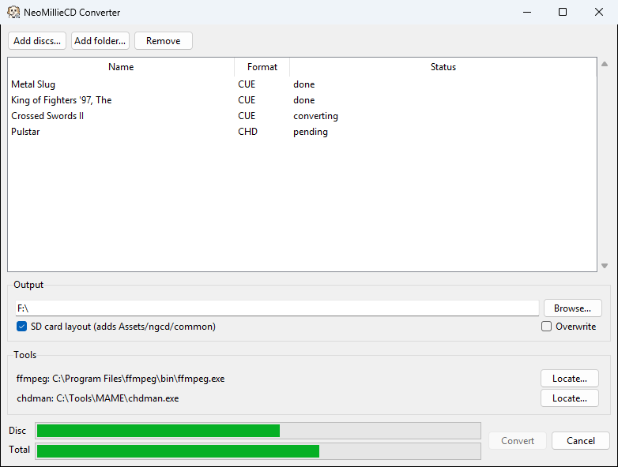

# NeoMillie Benutzerhandbuch

[English](manual.md) | [Español](manual.es.md) | [Français](manual.fr.md) | [Deutsch](manual.de.md) | [Italiano](manual.it.md) | [日本語](manual.ja.md)

Für NeoMillie und NeoMillieCD 0.6.0 auf dem Analogue Pocket.

NeoMillie spielt Neo-Geo-Cartridge-Spiele, wahlweise im Heimkonsolenmodus (AES) oder im Arcade-Modus (MVS). NeoMillieCD
spielt Neo-Geo-CD-Discs. Beide sind openFPGA-Cores. Keiner von beiden bringt ein BIOS, ein Spiel oder eine Disc mit: Die
besorgst du dir selbst.

Die Namen der Einstellungen erscheinen hier auf Englisch, so wie der Pocket sie anzeigt.

## Inhalt

1. [Was du brauchst](#was-du-brauchst)
2. [Ein Spiel starten](#ein-spiel-starten)
3. [Steuerung](#steuerung)
4. [Das Menü des Cartridge-Cores](#das-menü-des-cartridge-cores)
5. [Das Menü des CD-Cores](#das-menü-des-cd-cores)
6. [Disc-Images](#disc-images)
7. [Ladezeiten und Geschwindigkeit](#ladezeiten-und-geschwindigkeit)
8. [Spielstände](#spielstände)
9. [Dinge, die ein Spiel tut und die wie Fehler aussehen](#dinge-die-ein-spiel-tut-und-die-wie-fehler-aussehen)
10. [Wenn etwas schiefgeht](#wenn-etwas-schiefgeht)

## Was du brauchst

Lade die beiden Zip-Dateien von [Releases](https://github.com/uniplexed/neomillie/releases) herunter und entpacke jede
im Hauptverzeichnis der SD-Karte. Die Ordner werden dabei zusammengeführt. Danach legst du deine eigenen Dateien dazu.

Für Cartridge-Spiele, in `Assets/ng/common/`:

| Datei | Was es ist |
|---|---|
| `uni-bios_4_0.rom` | Das UniBIOS 4.0 |
| `000-lo.lo` | Das LO-ROM |
| `sfix.sfix` | Die Textebene des BIOS |
| Ein Ordner pro Spiel | Die ROMs des Spiels im Darksoft-Aufbau: `srom`, `prom`, `crom0`, `m1rom`, `vroma0` und `prom1`, wenn das Spiel eines hat |

Der Ordner eines Spiels trägt den Namen, den sein Eintrag in der Liste des Cores erwartet. Wenn du schon den Core Neo Geo
Overdrive benutzt, funktionieren dein BIOS und deine Spielordner hier unverändert.

Für Discs, in `Assets/ngcd/common/`:

| Datei | Was es ist |
|---|---|
| `uni-bioscd.rom` | Das UniBIOS CD, genau 524.288 Bytes groß. Der Core lädt es über seinen Namen |
| `000-lo.lo` | Das LO-ROM |
| Ein Ordner pro Disc | Die `.cue`-Datei der Disc mit der zugehörigen `.bin` daneben, zum Beispiel `Metal Slug/Metal Slug.cue` und `Metal Slug.bin` |

Eine Disc muss aus einer CUE und einer BIN bestehen. Wie du andere Formate umwandelst, steht in
[Disc-Images](#disc-images).

## Ein Spiel starten

Cartridge-Core: Öffne am Pocket openFPGA, dann Neo Geo, und wähle ein Spiel aus der Liste. Der Core lädt das BIOS und die
ROMs des Spiels und startet.

CD-Core: Öffne openFPGA, dann Neo Geo CD, dann NeoMillieCD. Das BIOS wird geladen und zeigt seinen eigenen Bildschirm.
Öffne das Menü des Pocket, gehe zu Core Settings und wähle beim Eintrag Disc die `.cue`-Datei der Disc. Das BIOS findet
die Disc und startet sie. Um die Disc zu wechseln, wählst du auf dieselbe Weise eine andere `.cue`.

Um einen der beiden Cores zu verlassen, öffne das Menü des Pocket und wähle Quit. Dann schreibt der Pocket deine
Spielstände auf die SD-Karte. Verlasse den Core also mit Quit und schalte den Pocket nicht mitten im Spiel aus.

## Steuerung

| Pocket | Neo Geo |
|---|---|
| Steuerkreuz | Joystick |
| A, B, X, Y | A, B, C, D |
| Start | Start |
| Select | Select an der Heimkonsole, und ein Münzeinwurf im Arcade-Modus |
| L | A und B zusammen, oder A, B und C zusammen |
| R | C und D zusammen, oder A, B und C zusammen |

Was L und R tun, stellst du bei [L/R Buttons](#lr-buttons) ein. Ein zweiter Controller über das Dock ist Spieler 2.

## Das Menü des Cartridge-Cores

Öffne bei laufendem Spiel das Menü des Pocket und gehe zu Core Settings. Der Pocket listet die Einträge des Cores in dieser
Reihenfolge auf. Die Nummern sind die, die dieser Abschnitt verwendet. Der Pocket zeigt eine einzige durchgehende Liste:
Die Gruppennamen stehen nur in diesem Bild.

Die meisten Einträge wirken sofort. Drei starten das Spiel neu, wenn du sie änderst: Reset Core, AES/MVS und 68K Clock.
Speichere vorher.

Der Pocket merkt sich alle Einträge für das nächste Mal, außer MVS DIP, Memory Card Unplugged, Mute und ADPCM-A Channel.
Diese springen bei jedem Öffnen des Cores auf ihren Standardwert zurück.

### System

1. Reset Core. Startet die Konsole neu. Vorher schreibt der Core die Memory Card auf die SD-Karte, und im MVS-Modus
   auch das Backup-RAM, sodass ein Reset keinen Spielstand verliert.

2. AES/MVS. Ein ist die Arcade-Platine (MVS), aus ist die Heimkonsole (AES). Ein ist der Standardwert. Das UniBIOS folgt
   diesem Eintrag von selbst: Der Eintrag SYSTEM im eigenen Menü des UniBIOS hat hier keine Wirkung. Im MVS-Modus wirft
   Select eine Münze ein, und das Spiel behält seine Einstellungen und Highscores im Backup-RAM. Eine Änderung startet das
   Spiel neu.

3. Region (Reset to apply). Japan, USA oder Europe, oder From the BIOS, um die Wahl der eigenen Einstellung des UniBIOS zu
   überlassen. From the BIOS ist der Standardwert. Spiele wählen mit der Region ihre Sprache, und manche zeigen oder
   verbergen damit Blut. Die neue Region wird beim Start der Konsole gelesen, benutze also nach der Änderung Reset Core.
   Das funktioniert nur mit dem UniBIOS.

4. MVS DIP. Die DIP-Schalter der Arcade-Platine. Settings öffnet das Test- und Einstellungsmenü der Platine, Freeplay
   lässt dich ohne Münzen spielen, und Freeze hält das Spiel an, solange es eingeschaltet ist. Die Liste bietet auch jedes
   Paar und alle drei zusammen an. Wenn Settings nichts bewirkt, benutze Reset Core bei eingeschaltetem Settings.

5. Memory Card Unplugged. Die Konsole sieht dann keine Memory Card. Nutze das bei einem Spiel, das bei jedem Start nach
   der Karte fragt, wenn du das nicht möchtest.

6. 68K Clock. Die Geschwindigkeit des Hauptprozessors der Konsole: 12 MHz wie beim Original, 16 MHz oder 24 MHz. Ein
   schnellerer Prozessor schafft in jedem Bild mehr Arbeit, sodass Szenen, die an einer echten Konsole ruckeln, weniger
   ruckeln. Das Spiel selbst läuft nicht schneller, denn sein Tempo folgt den 60 Bildern pro Sekunde des Bildschirms. Ton
   und Bildtiming ändern sich nicht. Eine Änderung startet das Spiel neu.

### Video

7. PAL Output. Lässt das Bild der Konsole mit den 50 Bildern pro Sekunde des PAL-Standards laufen, wie bei einer
   europäischen Konsole. Aus, der Standardwert, sind 60. Mit Ein laufen Spiele etwas langsamer. Das
   Bild behält seine 224 Zeilen.

8. 320/304 H Video Output. Ein zeigt alle 320 Spalten, die die Konsole zeichnet. Aus, der Standardwert, zeigt die mittleren
   304 und verbirgt damit die Spalten am Rand, in denen viele Spiele Datenmüll hinterlassen.

9. Video Scaler output. Das Seitenverhältnis des Bildes auf dem Bildschirm des Pocket: 19:15, 160:144, 4:3 oder 16:9. Das
   erste ist der Standardwert. Die Wahl 16:9 ist für einen Fernseher am Dock gedacht.

10. Screen X Position. Verschiebt das Bild nach links oder rechts, von -32 bis 32 Pixel. Eine positive Zahl verschiebt es
    nach rechts.

11. Screen Y Position. Verschiebt das Bild nach oben oder unten, von -16 bis 16 Zeilen. Eine positive Zahl verschiebt es
    nach unten.

### Audio

12. Stereo Mix. Mischt den linken und den rechten Kanal: None, 25%, 50% oder 100%, das ist Mono. Manche Spiele legen einen
    Klang ganz auf eine Seite, was über Kopfhörer anstrengend ist. Etwas Mix mildert das.

13. Mute. Schaltet eine oder mehrere der vier Quellen des Soundchips stumm: FM-Musik, die kurzen Samples (A), die langen
    Samples (B) und die Rechteckkanäle (PSG). Die Liste enthält jede Kombination.

14. ADPCM-A Channel. Die kurzen Samples laufen auf sechs Kanälen. Dieser Eintrag schaltet einen davon stumm oder lässt
    einen allein spielen (Solo).

Mute und ADPCM-A Channel dienen dazu, zu hören, wie ein Spiel seinen Sound aufbaut. Lass beide zum Spielen auf None.

### Steuerung

15. L/R Buttons. Was die Schultertasten drücken.

| Einstellung | L | R |
|---|---|---|
| A+B / C+D, der Standardwert | A und B | C und D |
| ABC / C+D | A, B und C | C und D |
| A+B / ABC | A und B | A, B und C |

## Das Menü des CD-Cores

Der CD-Core hat kein AES/MVS, kein Region (Reset to apply), kein MVS DIP und kein Memory Card Unplugged. Er hat drei eigene
Einträge, ganz oben. Die übrigen sind dieselben Einträge wie im Cartridge-Core und tun dasselbe.

Reset Core, CD/CDZ, CD Turbo 4x und 68K Clock starten das Spiel neu. Nach einem Neustart startet das BIOS wieder, und die Disc
bleibt eingelegt. Der Pocket merkt sich alles außer Mute und ADPCM-A Channel.

1. Reset Core. Startet die Konsole neu, nachdem die Memory Card auf die SD-Karte geschrieben wurde.

2. CD/CDZ. Welche Konsole der Core ist. Aus, der Standardwert, ist das erste Neo Geo CD, das die Disc mit einfacher
   Geschwindigkeit liest. Ein ist das CDZ, das mit doppelter Geschwindigkeit liest und daher in etwa der halben Zeit lädt.
   Das UniBIOS folgt diesem Eintrag von selbst. Eine Änderung startet das Spiel neu.

3. Region. US, EU, JP oder AS (Asia). US ist der Standardwert. Es ist die Region, die die Konsole selbst meldet, und
   Spiele nutzen sie wie die Region des Cartridge-Cores. Benutze nach der Änderung Reset Core.

4. CD Turbo 4x (beta). Liest die Daten der Disc mit der vierfachen einfachen Geschwindigkeit, bei ein- oder
   ausgeschaltetem CD/CDZ. Die Musik von der Disc spielt weiter mit normalem Tempo. Es ist nur mit dem UniBIOS und nur auf
   wenigen Discs getestet: Wenn sich ein Spiel damit falsch verhält, schalte es zuerst aus. Eine Änderung startet das
   Spiel neu.

5. 68K Clock. Wie im Cartridge-Core. Bei einer Disc verkürzt er außerdem die Ladezeiten ein wenig, da ein Teil des Ladens
   Arbeit des Prozessors selbst ist.

Die Einträge 6 bis 14 sind PAL Output, 320/304 H Video Output, Video Scaler output, Screen X Position, Screen Y Position,
Stereo Mix, Mute, ADPCM-A Channel und L/R Buttons, wie oben beschrieben. Bei einer Disc unterscheiden sich zwei Dinge.
Stereo Mix mischt auch die Musik der Disc. Mute schaltet die Musik der Disc nicht stumm, und seine Quelle B bewirkt
nichts, weil das Neo Geo CD keine langen Samples hat.

## Disc-Images

Der Core liest eine Disc als eine `.cue`, die eine `.bin` nennt, mit Spuren vom Typ `MODE1/2352` und `AUDIO`. Eine rohe
`.bin` mit einer Datenspur funktioniert ebenfalls.

Alle anderen Formen musst du zuerst mit dem NeoMillieCD Converter umwandeln, der an jedem
[Release](https://github.com/uniplexed/neomillie/releases) hängt. Er liest:

- eine `.cue` mit BIN-, ISO- oder WAV-Dateien, eine pro Spur oder gemeinsam genutzt, Big-Endian-Audio (`MOTOROLA`) oder
  Audio als MP3, OGG, FLAC, APE oder Opus;
- CloneCD (`.ccd` mit ihrer `.img`), Alcohol 120% (`.mds` mit ihrer `.mdf`, Version 1), Nero (`.nrg`) und DiscJuggler
  (`.cdi`, Versionen 2, 3 und 3.5);
- CHD (`.chd`).

Er liest deine Dateien, ohne sie zu verändern, und schreibt pro Disc einen Ordner mit einer CUE und einer BIN. Eine Disc
wird unter einem vorläufigen Namen geschrieben und erst umbenannt, wenn sie vollständig ist. Eine fehlgeschlagene oder
abgebrochene Disc hinterlässt deshalb nichts. Eine Disc, die schon am Ziel liegt, wird übersprungen, außer du lässt sie
überschreiben. Er lehnt `MODE2`-Spuren und Discs mit mehr als einer Session ab, die Spiele für das Neo Geo CD nicht
verwenden.

### Das Fenster

Lade die Zip-Datei für dein System herunter und entpacke sie:

| System | Datei |
|---|---|
| Windows x64 | `NeoMillieCD-Converter-windows-x64.zip` |
| macOS auf Apple Silicon | `NeoMillieCD-Converter-macos-arm64.zip` |
| Linux x64 | `NeoMillieCD-Converter-linux-x64.zip` |

Die Programme sind nicht signiert. Beim ersten Mal fragt Windows SmartScreen nach: Wähle *More info* und dann
*Run anyway*. Unter macOS öffnest du die App einmal, schließt die Meldung, dass sie nicht überprüft werden kann, und wählst
dann in den Systemeinstellungen unter Datenschutz & Sicherheit *Open Anyway*. Für Intel-Macs gibt es keinen Build: Nimm
das Skript unten mit Python.

#### Schritt für Schritt

1. Öffne das Programm. Das Fenster ist zu Beginn leer.

   

2. Füge deine Discs hinzu. *Add discs…* wählt Image-Dateien (`.cue`, `.chd`, `.ccd`, `.mds`, `.nrg`, `.cdi`);
   *Add folder…* wählt einen Ordner und findet jede Disc darin und in seinen Unterordnern. Jede Disc bekommt eine Zeile
   mit ihrem Namen, ihrem Format und ihrem Status. Der Name ist der, den Ordner und Dateien der Disc auf der SD-Karte
   bekommen: Doppelklicke darauf, um ihn zu ändern. *Remove* nimmt die ausgewählten Zeilen aus der Liste.
3. Wähle mit *Browse…*, wohin die Discs kommen. Mit *SD card layout* auf Ein wählst du die Wurzel der SD-Karte, und jede
   Disc landet in `Assets/ngcd/common/`, wo der Core sie sucht. Auf Aus landen die Discs in dem Ordner, den du wählst.
   Eine Disc, die schon dort liegt, wird übersprungen, außer *Overwrite* ist an.

   

4. Sieh dir die Statusspalte an. Eine Disc mit *needs chdman* oder *needs ffmpeg* wartet auf dieses Programm:
   Installiere es (siehe [ffmpeg und chdman](#ffmpeg-und-chdman)) oder drücke daneben *Locate…* und wähle das Programm.
   Die Disc wechselt auf *pending*.

   

5. Drücke *Convert*. Der Balken *Disc* zeigt die Disc, die gerade konvertiert wird, und *Total* die ganze Liste.
   *Cancel* bricht ab: Die Disc, die gerade konvertiert wird, fällt ganz weg, nichts bleibt halb geschrieben, und die
   schon fertigen Discs bleiben.

   

6. Wenn jede Zeile *done* zeigt, sind die Discs fertig: ein Ordner pro Disc, jeder mit einer `.cue` und einer `.bin`.
   Stecke die SD-Karte in den Pocket und wähle in den Core Settings des CD-Cores beim Eintrag Disc die `.cue`-Datei der
   Disc. Eine Disc, die fehlgeschlagen ist, nennt in ihrer Zeile den Grund; die anderen werden trotzdem konvertiert.

   

Das Fenster merkt sich das Ziel und wo ffmpeg und `chdman` liegen.

### Das Skript

`NeoMillieCD-Converter-python.zip` enthält denselben Konverter als Python-Skripte, für jedes System mit Python 3.8 oder
neuer:

    python cd_convert.py SOURCE... DEST [--name NAME] [--overwrite]
    python cd_convert_gui.py

SOURCE ist ein Disc-Image oder ein Ordner. Für die Ordnerstruktur des Cores ist DEST `<SD card>/Assets/ngcd/common`. Der
Name jeder Disc ist der Name des Images bis zur ersten Klammer, also wird aus `Metal Slug (1996)(SNK)(Jp-US)[!]` der Name
`Metal Slug`. `--name` legt ihn für eine Disc fest. Unter Linux braucht das Fenster eventuell `python3-tk` aus der
Distribution.

### ffmpeg und chdman

Keins von beiden liegt dem Konverter bei. Er sucht beide im PATH oder neben dem Konverter, und das Fenster hat *Locate*
dafür.

| Gebraucht für | Windows | macOS | Debian und Ubuntu |
|---|---|---|---|
| Komprimiertes Audio: ffmpeg | `winget install Gyan.FFmpeg` | `brew install ffmpeg` | `sudo apt install ffmpeg` |
| CHD: chdman | `chdman.exe` aus [MAME](https://www.mamedev.org/) | `brew install rom-tools` | `sudo apt install mame-tools` |

## Ladezeiten und Geschwindigkeit

Drei Einstellungen ändern, wie lange eine Disc zum Laden braucht. Hier siehst du sieben Ladevorgänge von The King of
Fighters '99, zusammengezählt und vom Core selbst auf einem Pocket gemessen.

| CD/CDZ | CD Turbo 4x | 68K Clock | Sieben Ladevorgänge |
|---|---|---|---|
| Aus | Aus | 12 MHz | 66,3 s |
| Ein | Aus | 12 MHz | 38,4 s |
| Aus | Ein | 12 MHz | 27,8 s |
| Ein | Ein | 12 MHz | 27,8 s |
| Ein | Ein | 16 MHz | 24,5 s |
| Ein | Ein | 24 MHz | 23,6 s |

CD/CDZ auf Ein ist die getestete Einstellung für den Alltag. CD Turbo 4x bringt den größten Gewinn und ist noch
in der Beta. Der 68K Clock hilft beim Laden nur wenig: Sein eigentlicher Nutzen sind die Verlangsamungen in
überladenen Szenen.

## Spielstände

| Core | Spielstand | Datei auf der SD-Karte |
|---|---|---|
| Cartridge | Memory Card, eine pro Spiel | `Saves/ng/uniplexed.NeoMillie/`, nach dem Spiel benannt, `.sav` |
| Cartridge, MVS-Modus | Backup-RAM: die Einstellungen der Platine, Highscores und Buchhaltung | `Saves/ng/common/backup.bak` |
| CD | Memory Card, eine für alle Discs | `Saves/ngcd/common/uni-bioscd.sav` |

Der Pocket schreibt diese Dateien, wenn du Quit wählst, wenn er in den Ruhezustand geht und wenn du ihn über sein Menü
ausschaltest. Der Core schreibt sie auch bei Reset Core. Ein Spielstand, der in einem Spiel angelegt wurde, liegt im
Speicher der Konsole, bis eines davon geschieht.

Spielstände vom Core Neo Geo Overdrive lassen sich in diesem Core nicht laden, und es gibt keinen Konverter.

## Dinge, die ein Spiel tut und die wie Fehler aussehen

Fatal Fury 3 auf CD macht den Bildschirm direkt nach dem ersten „Fight“ eines Kampfes fast eine Sekunde lang schwarz, und
beim Ende einer Runde noch einmal kürzer. Das Spiel macht das selbst: Es schaltet das Bild aus, während es die Stimmen
des Ansagers gegen die der Kämpfer austauscht, ein Viertelmegabyte, das der Prozessor kopiert. Eine echte Konsole braucht
dieselbe Zeit. Mit dem 68K Clock auf 24 MHz sind das Kopieren und der schwarze Bildschirm kürzer.

Der Eintrag SYSTEM des UniBIOS zeigt einen Konsolentyp an und lässt dich ihn ändern. In diesen Cores hat er keine Wirkung.
AES/MVS entscheidet bei Cartridges und CD/CDZ bei Discs.

Nach einer Änderung von AES/MVS, CD/CDZ, CD Turbo 4x oder 68K Clock startet das Spiel neu. Dann tritt die Einstellung in
Kraft.

## Wenn etwas schiefgeht

| Was du siehst | Was du prüfen solltest |
|---|---|
| Das CD-BIOS meldet, dass keine Disc da ist | Die `.cue` nennt genau eine `.bin`, im selben Ordner und mit derselben Schreibweise. Ihre Spuren sind `MODE1/2352` oder `AUDIO`. Eine CUE mit `WAVE`-Dateien, mehreren `FILE`-Zeilen oder `MODE1/2048` braucht den [Konverter](#disc-images) |
| Eine Disc lädt nicht mehr weiter oder verhält sich mit CD Turbo 4x auf Ein falsch | Schalte CD Turbo 4x aus und versuche es noch einmal |
| Ein Cartridge-Spiel steht nicht in der Liste oder startet nicht | Sein Ordner in `Assets/ng/common/` trägt den Namen, den die Liste erwartet, und enthält jede Datei, die unter [Was du brauchst](#was-du-brauchst) genannt ist |
| Ein Spielstand ist weg | Der Core wurde ohne Quit verlassen. Siehe [Spielstände](#spielstände) |
| Region hat bei einem Cartridge keine Wirkung | Es braucht das UniBIOS und nach der Änderung ein Reset Core |
| Das Bild ist links oder rechts abgeschnitten | Schalte 320/304 H Video Output ein oder verschiebe es mit Screen X Position |

Für alles andere eröffne ein Issue unter [github.com/uniplexed/neomillie](https://github.com/uniplexed/neomillie/issues)
und nenne Core, Version, BIOS, Spiel und Einstellungen.

Wie die Cores aufgebaut sind, steht in [architecture.md](architecture.md), auf Englisch.
