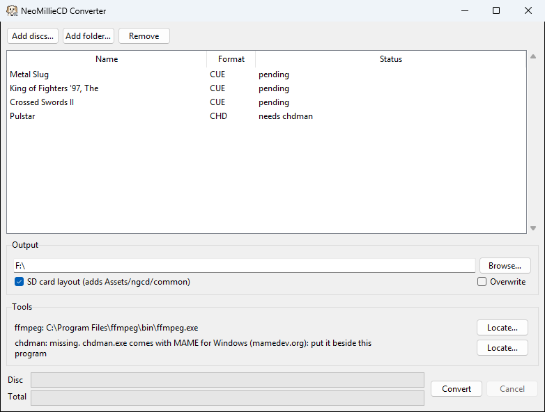
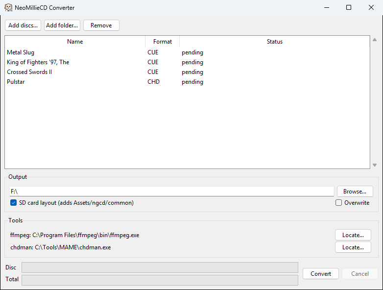

# Manual de usuario de NeoMillie

[English](manual.md) | [Español](manual.es.md) | [Français](manual.fr.md) | [Deutsch](manual.de.md) | [Italiano](manual.it.md) | [日本語](manual.ja.md)

Para NeoMillie y NeoMillieCD 0.6.0 en la Analogue Pocket.

NeoMillie es un core FPGA para la Analogue Pocket que permite jugar a juegos de Neo Geo. Está portado del RTL de Neo Geo
del proyecto MiSTer. NeoMillie ejecuta los juegos de cartucho como una consola doméstica (AES) o una placa recreativa
(MVS), y NeoMillieCD, los discos de Neo Geo CD. Los dos son cores de openFPGA. Ninguno incluye BIOS, juegos ni discos:
los pones tú.

Los nombres de los ajustes aparecen aquí en inglés, tal como los muestra la Pocket.

## Contenido

1. [Qué necesitas](#qué-necesitas)
2. [Arrancar un juego](#arrancar-un-juego)
3. [Controles](#controles)
4. [El menú del core de cartuchos](#el-menú-del-core-de-cartuchos)
5. [El menú del core de CD](#el-menú-del-core-de-cd)
6. [Imágenes de disco](#imágenes-de-disco)
7. [Tiempos de carga y velocidad](#tiempos-de-carga-y-velocidad)
8. [Partidas guardadas](#partidas-guardadas)
9. [Cosas que hace un juego y parecen fallos](#cosas-que-hace-un-juego-y-parecen-fallos)
10. [Si algo va mal](#si-algo-va-mal)

## Qué necesitas

Descarga los dos zips de [Releases](https://github.com/uniplexed/neomillie/releases) y descomprime cada uno en la raíz de
la tarjeta SD, combinando las carpetas. Después añade tus propios ficheros.

Para juegos de cartucho, en `Assets/ng/common/`:

| Fichero | Qué es |
|---|---|
| `uni-bios_4_0.rom` | La UniBIOS 4.0 |
| `000-lo.lo` | La ROM LO |
| `sfix.sfix` | La capa de texto de la BIOS |
| Una carpeta por juego | Las ROM del juego con la organización Darksoft: `srom`, `prom`, `crom0`, `m1rom`, `vroma0`, y `prom1` si el juego la tiene |

Cada carpeta de juego se llama como espera su entrada en la lista del core. Si ya usas el core Neo Geo Overdrive, tu BIOS
y tus carpetas de juegos sirven aquí tal como están.

Para discos, en `Assets/ngcd/common/`:

| Fichero | Qué es |
|---|---|
| `uni-bioscd.rom` | La UniBIOS CD, de 524.288 bytes exactos. El core la carga por su nombre |
| `000-lo.lo` | La ROM LO |
| Una carpeta por disco | El `.cue` del disco con su `.bin` al lado, por ejemplo `Metal Slug/Metal Slug.cue` y `Metal Slug.bin` |

Cada disco tiene que ser un CUE con un BIN. [Imágenes de disco](#imágenes-de-disco) explica cómo convertir los demás
formatos.

## Arrancar un juego

Core de cartuchos: en la Pocket abre openFPGA, luego Neo Geo, y elige un juego de la lista. El core carga la BIOS y las ROM
del juego y arranca.

Core de CD: abre openFPGA, luego Neo Geo CD, luego NeoMillieCD. La BIOS se carga y muestra su propia pantalla. Abre el
menú de la Pocket, entra en Core Settings y elige el `.cue` del disco en la entrada Disc. La BIOS encuentra el disco y lo
arranca. Para cambiar de disco, elige otro `.cue` de la misma forma.

Para salir de cualquiera de los dos cores, abre el menú de la Pocket y elige Quit. En ese momento la Pocket escribe tus
partidas en la tarjeta SD, así que sal con Quit en lugar de apagar la Pocket a mitad de juego.

## Controles

| Pocket | Neo Geo |
|---|---|
| Cruceta | Palanca |
| A, B, X, Y | A, B, C, D |
| Start | Start |
| Select | Select en la consola doméstica, y una moneda en modo recreativa |
| L | A y B a la vez, o A, B y C a la vez |
| R | C y D a la vez, o A, B y C a la vez |

Lo que hacen L y R se elige en [L/R Buttons](#lr-buttons). Un segundo mando, conectado al Dock, es el jugador 2.

## El menú del core de cartuchos

Con un juego en marcha, abre el menú de la Pocket y entra en Core Settings. La Pocket muestra los ajustes del core en el
orden de abajo, con los mismos números que la imagen. En la Pocket forman una sola lista seguida, sin los nombres de
grupo.

Casi todos los ajustes actúan al momento. Tres reinician el juego al cambiarlos: Reset Core, AES/MVS y 68K Clock, así que
guarda la partida antes de tocarlos.

La Pocket recuerda todos los ajustes para la próxima vez, salvo MVS DIP, Memory Card Unplugged, Mute y ADPCM-A Channel,
que vuelven a su valor por defecto cada vez que abres el core.

### Sistema

1. Reset Core. Reinicia la consola. Antes, el core escribe la tarjeta de memoria en la SD, y en modo MVS también la RAM
   de respaldo, así que al reiniciar no pierdes ninguna partida.

2. AES/MVS. Activado es la placa recreativa (MVS), y es el valor por defecto; desactivado es la consola doméstica (AES).
   La UniBIOS sigue este ajuste por sí sola: la opción SYSTEM del menú propio de la UniBIOS no tiene efecto aquí. En modo
   MVS, Select mete una moneda y el juego guarda su configuración y sus récords en la RAM de respaldo. Cambiarlo reinicia
   el juego.

3. Region (Reset to apply). Japan, USA o Europe, o From the BIOS, el valor por defecto, para dejar la elección al ajuste
   propio de la UniBIOS. Los juegos usan la región para elegir el idioma, y algunos para mostrar u ocultar la sangre. La
   consola lee la región al arrancar, así que usa Reset Core después de cambiarla. Solo funciona con la UniBIOS.

4. MVS DIP. Los interruptores DIP de la placa recreativa. Settings abre el menú de pruebas y configuración de la placa,
   Freeplay permite jugar sin monedas y Freeze detiene el juego mientras está activado. La lista ofrece también cada
   pareja y los tres juntos. Si Settings no hace nada, usa Reset Core con Settings activado.

5. Memory Card Unplugged. La consola deja de ver la tarjeta de memoria. Sirve para los juegos que preguntan por la
   tarjeta cada vez que arrancan, si no quieres que lo hagan.

6. 68K Clock. La velocidad del procesador principal de la consola: 12 MHz como el original, 16 MHz o 24 MHz. Con un
   procesador más rápido cabe más trabajo en cada fotograma, así que las escenas que se ralentizan en una consola real se
   ralentizan menos. El juego en sí no va más deprisa, porque su ritmo sigue los 60 fotogramas por segundo de la
   pantalla. El sonido y los tiempos de la imagen no cambian. Cambiarlo reinicia el juego.

### Vídeo

7. PAL Output. Pone la imagen de la consola a 50 fotogramas por segundo, los de la norma PAL, como una consola europea.
   Desactivado, el valor por defecto, son 60. Con él activado los juegos van un poco más lentos. La imagen conserva sus
   224 líneas.

8. 320/304 H Video Output. Activado muestra las 320 columnas que dibuja la consola. Desactivado, el valor por defecto,
   muestra las 304 centrales y oculta las columnas de los bordes, donde muchos juegos dejan restos gráficos.

9. Video Scaler output. La forma de la imagen en la pantalla de la Pocket: 19:15, 160:144, 4:3 o 16:9. La primera es el
   valor por defecto. La opción 16:9 está pensada para un televisor conectado al Dock.

10. Screen X Position. Mueve la imagen a izquierda o derecha, de -32 a 32 píxeles. Un número positivo la mueve a la
    derecha.

11. Screen Y Position. Mueve la imagen arriba o abajo, de -16 a 16 líneas. Un número positivo la mueve hacia abajo.

### Audio

12. Stereo Mix. Mezcla los canales izquierdo y derecho: None, 25%, 50% o 100%, que es mono. Algunos juegos ponen un
    sonido solo en un lado, y con auriculares eso cansa; un poco de mezcla lo suaviza.

13. Mute. Silencia una o varias de las cuatro fuentes del chip de sonido: la música FM, las muestras cortas (A), las
    muestras largas (B) y los canales de onda cuadrada (PSG). La lista tiene todas las combinaciones.

14. ADPCM-A Channel. Las muestras cortas suenan por seis canales. Este ajuste silencia uno de ellos, o deja sonar uno
    solo (Solo).

Mute y ADPCM-A Channel sirven para escuchar cómo construye un juego su sonido. Para jugar, déjalos en None.

### Controles

15. L/R Buttons. Qué botones de la Neo Geo pulsan L y R.

| Ajuste | L | R |
|---|---|---|
| A+B / C+D, por defecto | A y B | C y D |
| ABC / C+D | A, B y C | C y D |
| A+B / ABC | A y B | A, B y C |

## El menú del core de CD

El core de CD no tiene AES/MVS, Region (Reset to apply), MVS DIP ni Memory Card Unplugged. Tiene tres ajustes propios, al
principio. El resto son los mismos que en el core de cartuchos y hacen lo mismo.

Reset Core, CD/CDZ, CD Turbo 4x y 68K Clock reinician el juego. Tras un reinicio la BIOS arranca de nuevo y el disco sigue
puesto. La Pocket lo recuerda todo salvo Mute y ADPCM-A Channel.

1. Reset Core. Reinicia la consola, después de escribir la tarjeta de memoria en la SD.

2. CD/CDZ. Elige qué consola reproduce el core. Desactivado, el valor por defecto, es la primera Neo Geo CD, que lee el
   disco a velocidad simple. Activado es la CDZ, que lee a doble velocidad y por eso tarda más o menos la mitad en
   cargar. La UniBIOS sigue este ajuste por sí sola. Cambiarlo reinicia el juego.

3. Region. US, EU, JP o AS (Asia). US es el valor por defecto. Es la región que declara la propia consola, y los juegos
   la usan igual que el ajuste Region del core de cartuchos. Usa Reset Core después de cambiarla.

4. CD Turbo 4x (beta). Lee los datos del disco a cuatro veces la velocidad simple, con CD/CDZ activado o no. La
   música del disco sigue sonando a velocidad normal. Solo está probado con la UniBIOS y en pocos discos: si un juego se
   comporta mal con él, lo primero es desactivarlo. Cambiarlo reinicia el juego.

5. 68K Clock. Igual que en el core de cartuchos. Con un disco además acorta un poco las cargas, porque parte de cada
   carga la hace el propio procesador.

Los ajustes 6 a 14 son PAL Output, 320/304 H Video Output, Video Scaler output, Screen X Position, Screen Y Position,
Stereo Mix, Mute, ADPCM-A Channel y L/R Buttons, tal como se describen arriba. Con un disco cambian dos cosas: Stereo Mix
mezcla también la música del disco, y Mute no silencia esa música. Además, la fuente B de Mute no hace nada, porque la
Neo Geo CD no tiene muestras largas.

## Imágenes de disco

El core lee un disco como un `.cue` que nombra un `.bin`, con pistas de tipo `MODE1/2352` y `AUDIO`. También sirve un
`.bin` suelto con una sola pista de datos.

Cualquier otro formato hay que convertirlo antes con el NeoMillieCD Converter, que viene adjunto a cada
[release](https://github.com/uniplexed/neomillie/releases). Lee:

- un `.cue` con ficheros BIN, ISO o WAV, uno por pista o compartidos, audio big-endian (`MOTOROLA`), o audio MP3, OGG,
  FLAC, APE u Opus;
- CloneCD (`.ccd` con su `.img`), Alcohol 120% (`.mds` con su `.mdf`, versión 1), Nero (`.nrg`) y DiscJuggler (`.cdi`,
  versiones 2, 3 y 3.5);
- CHD (`.chd`).

El conversor no modifica tus ficheros y escribe una carpeta por disco con un CUE y un BIN. Escribe cada disco con un
nombre temporal y solo le pone el definitivo cuando está completo, así que un disco que falla o se cancela no deja nada.
Si un disco ya está en el destino, lo salta, salvo que pidas sobrescribirlo. Rechaza las pistas `MODE2` y los discos con
más de una sesión, que los juegos de Neo Geo CD no usan.

### La ventana

Descarga el zip de tu sistema y descomprímelo:

| Sistema | Fichero |
|---|---|
| Windows x64 | `NeoMillieCD-Converter-windows-x64.zip` |
| macOS en Apple Silicon | `NeoMillieCD-Converter-macos-arm64.zip` |
| Linux x64 | `NeoMillieCD-Converter-linux-x64.zip` |

Cada programa es autocontenido. Está hecho con PyInstaller y lleva dentro su propio intérprete de Python, la biblioteca
Tcl/Tk que dibuja la ventana y las bibliotecas que usa Python, como OpenSSL, zlib, bzip2 y xz. El de Linux lleva además
las bibliotecas X11, fontconfig y FreeType que necesita la ventana. No hay que instalar nada para usarlo, y por eso cada
zip ocupa entre 10 y 25 MB, frente a los 56 KB de los scripts. ffmpeg y chdman no van dentro: consulta [ffmpeg y
chdman](#ffmpeg-y-chdman). Las licencias de todo lo que llevan están en `THIRD-PARTY-LICENSES.txt`, dentro de cada zip.

Los programas no están firmados. La primera vez, Windows SmartScreen pregunta: elige *More info* y luego *Run anyway*. En
macOS, abre la app una vez, cierra el mensaje de que no se puede comprobar y luego, en Ajustes del Sistema, Privacidad y
seguridad, elige *Open Anyway*. No hay versión para Mac con Intel: usa el script de abajo con Python.

#### Paso a paso

1. Abre el programa. La ventana empieza vacía.

   

2. Añade tus discos. *Add discs…* elige ficheros de imagen (`.cue`, `.chd`, `.ccd`, `.mds`, `.nrg`, `.cdi`);
   *Add folder…* elige una carpeta y encuentra todos los discos que hay en ella y en sus subcarpetas. Cada disco ocupa
   una fila con su nombre, su formato y su estado. El nombre es como se llamarán la carpeta y los ficheros del disco en
   la tarjeta SD: haz doble clic en él para cambiarlo. *Remove* quita de la lista las filas seleccionadas.
3. Elige adónde van los discos con *Browse…*. Con *SD card layout* activado, elige la raíz de la tarjeta SD y cada disco
   va a `Assets/ngcd/common/`, donde el core lo busca. Con la opción desactivada, los discos van a la carpeta que
   elijas. Si un disco ya está allí, el conversor lo salta, salvo que *Overwrite* esté activado.

   

4. Mira la columna de estado. Un disco que dice *needs chdman* o *needs ffmpeg* espera a ese programa. Instálalo
   (consulta [ffmpeg y chdman](#ffmpeg-y-chdman)), o pulsa *Locate…* junto al nombre del programa, en *Tools*, y elige
   el programa. El disco pasa entonces a *pending*.

   

5. Pulsa *Convert*. La barra *Disc* sigue el disco que se está convirtiendo, y *Total*, la lista entera. *Cancel*
   detiene la conversión: el disco que se estaba convirtiendo se descarta entero, sin nada escrito a medias, y los
   discos ya terminados se conservan.

   

6. Cuando todas las filas dicen *done*, los discos están listos: una carpeta por disco, cada una con un `.cue` y un
   `.bin`. Pon la tarjeta SD en la Pocket y, en Core Settings del core de CD, elige el `.cue` del disco en la entrada
   Disc. Un disco que ha fallado dice por qué en su fila; los demás se convierten igualmente.

   

La ventana recuerda el destino, si *SD card layout* está activado y dónde están ffmpeg y `chdman`.

### El script

`NeoMillieCD-Converter-python.zip` contiene el mismo conversor como scripts de Python, para cualquier sistema con Python
3.8 o posterior:

    python cd_convert.py SOURCE... DEST [--name NAME] [--overwrite]
    python cd_convert_gui.py

SOURCE es una imagen de disco o una carpeta. Para la estructura del core, DEST es `<SD card>/Assets/ngcd/common`. El
nombre de cada disco es el de la imagen hasta su primer paréntesis o corchete, así que `Metal Slug (1996)(SNK)(Jp-US)[!]`
se convierte en `Metal Slug`; `--name` lo fija para un disco. En Linux la ventana puede necesitar el `python3-tk` de la
distribución.

### ffmpeg y chdman

Ninguno de los dos viene con el conversor. Los busca junto al conversor y en el PATH, y en la ventana puedes indicar
dónde están con *Locate…*.

| Necesario para | Windows | macOS | Debian y Ubuntu |
|---|---|---|---|
| Audio comprimido: ffmpeg | `winget install Gyan.FFmpeg` | `brew install ffmpeg` | `sudo apt install ffmpeg` |
| CHD: chdman | `chdman.exe` de [MAME](https://www.mamedev.org/) | `brew install rom-tools` | `sudo apt install mame-tools` |

## Tiempos de carga y velocidad

Tres ajustes cambian lo que tarda en cargar un disco. Los tiempos de la tabla suman siete cargas de The King of Fighters
'99, cronometradas por el propio core en una Pocket.

| CD/CDZ | CD Turbo 4x | 68K Clock | Siete cargas |
|---|---|---|---|
| Desactivado | Desactivado | 12 MHz | 66,3 s |
| Activado | Desactivado | 12 MHz | 38,4 s |
| Desactivado | Activado | 12 MHz | 27,8 s |
| Activado | Activado | 12 MHz | 27,8 s |
| Activado | Activado | 16 MHz | 24,5 s |
| Activado | Activado | 24 MHz | 23,6 s |

CD/CDZ activado es el ajuste probado para el uso diario. CD Turbo 4x es el que más recorta, pero sigue en beta. El 68K
Clock acorta poco las cargas; sirve sobre todo contra la ralentización en escenas con mucho movimiento.

## Partidas guardadas

| Core | Guardado | Fichero en la tarjeta SD |
|---|---|---|
| Cartuchos | Tarjeta de memoria, una por juego | `Saves/ng/uniplexed.NeoMillie/`, con el nombre del juego, `.sav` |
| Cartuchos, modo MVS | RAM de respaldo: la configuración de la placa, los récords y la contabilidad | `Saves/ng/common/backup.bak` |
| CD | Tarjeta de memoria, una para todos los discos | `Saves/ngcd/common/uni-bioscd.sav` |

La Pocket escribe estos ficheros cuando eliges Quit, cuando entra en reposo y cuando la apagas desde su menú. El core los
escribe además en Reset Core. Hasta entonces, lo que guardas dentro de un juego solo está en la memoria de la consola.

Las partidas del core Neo Geo Overdrive no cargan en este, y no hay conversor.

## Cosas que hace un juego y parecen fallos

Fatal Fury 3 en CD deja la pantalla en negro casi un segundo justo después del primer "Fight" de un combate, y otra vez,
menos tiempo, al terminar un asalto. Lo hace el propio juego: apaga la imagen mientras cambia las voces del presentador por
las de los luchadores, un cuarto de megabyte que copia el procesador. Una consola real tarda lo mismo. Con el 68K Clock a
24 MHz la copia, y con ella la pantalla negra, duran menos.

La opción SYSTEM de la UniBIOS muestra un tipo de consola y deja cambiarlo. En estos cores no tiene efecto: en cartuchos
manda AES/MVS, y en discos, CD/CDZ.

El juego se reinicia cuando cambias AES/MVS, CD/CDZ, CD Turbo 4x o el 68K Clock. Así se aplica el ajuste nuevo; no es
un cuelgue.

## Si algo va mal

| Lo que ves | Qué comprobar |
|---|---|
| La BIOS de CD dice que no hay disco | El `.cue` nombra exactamente un `.bin`, en la misma carpeta y escrito igual. Sus pistas son `MODE1/2352` o `AUDIO`. Un CUE con ficheros `WAVE`, varias líneas `FILE` o `MODE1/2048` necesita el [conversor](#imágenes-de-disco) |
| Un disco deja de cargar o se comporta mal con CD Turbo 4x activado | Desactiva CD Turbo 4x y prueba otra vez |
| Un juego de cartucho no está en la lista, o no arranca | Su carpeta en `Assets/ng/common/` tiene el nombre que espera la lista, y contiene todos los ficheros de [Qué necesitas](#qué-necesitas) |
| Ha desaparecido una partida | Saliste del core sin pasar por Quit. Mira [Partidas guardadas](#partidas-guardadas) |
| Region no tiene efecto en un cartucho | Necesita la UniBIOS, y un Reset Core después del cambio |
| La imagen sale cortada a izquierda o derecha | Activa 320/304 H Video Output, o muévela con Screen X Position |

Para cualquier otra cosa, abre una incidencia en
[github.com/uniplexed/neomillie](https://github.com/uniplexed/neomillie/issues) e indica el core, la versión, la BIOS, el
juego y los ajustes.

[architecture.md](architecture.md), en inglés, explica cómo están construidos los cores.
