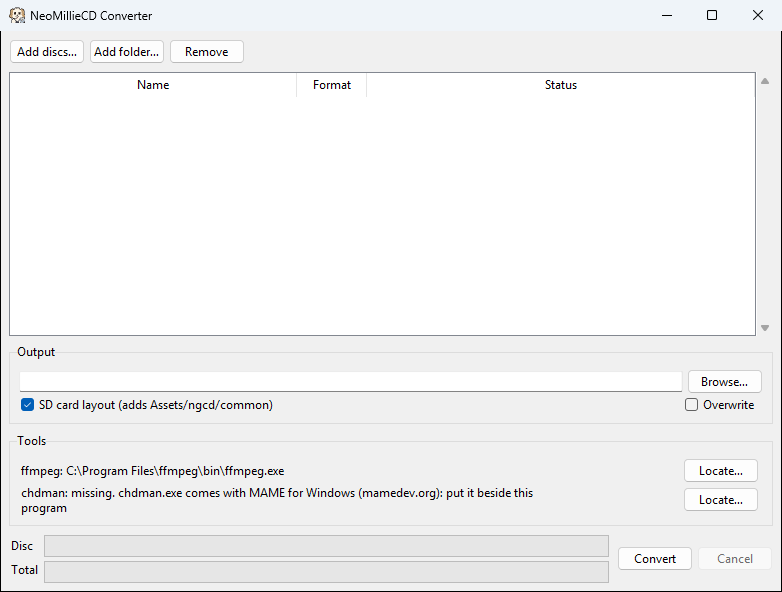

# Manuel d'utilisation de NeoMillie

[English](manual.md) | [Español](manual.es.md) | [Français](manual.fr.md) | [Deutsch](manual.de.md) | [Italiano](manual.it.md) | [日本語](manual.ja.md)

Pour NeoMillie et NeoMillieCD 0.6.0 sur l'Analogue Pocket.

NeoMillie est un core FPGA pour l'Analogue Pocket qui permet de jouer aux jeux Neo Geo. Il est porté depuis le RTL Neo
Geo du projet MiSTer. NeoMillie fait tourner les jeux sur cartouche comme une console de salon (AES) ou une borne
d'arcade (MVS), et NeoMillieCD les disques Neo Geo CD. Les deux sont des cores openFPGA. Aucun ne contient de BIOS, de
jeu ni de disque : c'est à vous de les fournir.

Les noms des réglages apparaissent ici en anglais, tels que la Pocket les affiche.

## Sommaire

1. [Ce dont vous avez besoin](#ce-dont-vous-avez-besoin)
2. [Lancer un jeu](#lancer-un-jeu)
3. [Commandes](#commandes)
4. [Le menu du core cartouche](#le-menu-du-core-cartouche)
5. [Le menu du core CD](#le-menu-du-core-cd)
6. [Images de disque](#images-de-disque)
7. [Temps de chargement et vitesse](#temps-de-chargement-et-vitesse)
8. [Sauvegardes](#sauvegardes)
9. [Ce que fait un jeu et qui ressemble à des défauts](#ce-que-fait-un-jeu-et-qui-ressemble-à-des-défauts)
10. [En cas de problème](#en-cas-de-problème)

## Ce dont vous avez besoin

Téléchargez les deux fichiers zip depuis [Releases](https://github.com/uniplexed/neomillie/releases) et décompressez
chacun à la racine de la carte SD, en fusionnant les dossiers. Ajoutez ensuite vos propres fichiers.

Pour les jeux sur cartouche, dans `Assets/ng/common/` :

| Fichier | Rôle |
|---|---|
| `uni-bios_4_0.rom` | L'UniBIOS 4.0 |
| `000-lo.lo` | La ROM LO |
| `sfix.sfix` | La couche de texte du BIOS |
| Un dossier par jeu | Les ROM du jeu selon l'organisation Darksoft : `srom`, `prom`, `crom0`, `m1rom`, `vroma0`, et `prom1` si le jeu en a une |

Le dossier d'un jeu porte le nom qu'attend son entrée dans la liste du core. Si vous utilisez déjà le core Neo Geo
Overdrive, votre BIOS et vos dossiers de jeux fonctionnent ici tels quels.

Pour les disques, dans `Assets/ngcd/common/` :

| Fichier | Rôle |
|---|---|
| `uni-bioscd.rom` | L'UniBIOS CD, de 524 288 octets exactement. Le core la charge par son nom |
| `000-lo.lo` | La ROM LO |
| Un dossier par disque | Le `.cue` du disque avec son `.bin` à côté, par exemple `Metal Slug/Metal Slug.cue` et `Metal Slug.bin` |

Un disque doit être un CUE avec un BIN. [Images de disque](#images-de-disque) explique comment convertir les autres
formats.

## Lancer un jeu

Core cartouche : sur la Pocket, ouvrez openFPGA, puis Neo Geo, et choisissez un jeu dans la liste. Le core charge le BIOS
et les ROM du jeu, puis démarre.

Core CD : ouvrez openFPGA, puis Neo Geo CD, puis NeoMillieCD. Le BIOS se charge et affiche son propre écran. Ouvrez le menu
de la Pocket, allez dans Core Settings et choisissez le `.cue` du disque sur l'entrée Disc. Le BIOS trouve le disque et le
lance. Pour changer de disque, choisissez un autre `.cue` de la même façon.

Pour quitter l'un ou l'autre core, ouvrez le menu de la Pocket et choisissez Quit. C'est à ce moment que la Pocket écrit
vos sauvegardes sur la carte SD : quittez donc avec Quit plutôt que d'éteindre la Pocket en pleine partie.

## Commandes

| Pocket | Neo Geo |
|---|---|
| Croix directionnelle | Joystick |
| A, B, X, Y | A, B, C, D |
| Start | Start |
| Select | Select sur la console de salon, et une pièce en mode arcade |
| L | A et B ensemble, ou A, B et C ensemble |
| R | C et D ensemble, ou A, B et C ensemble |

Le rôle de L et R se règle dans [L/R Buttons](#lr-buttons). Une seconde manette, branchée au Dock, est le joueur 2.

## Le menu du core cartouche

Avec un jeu en cours, ouvrez le menu de la Pocket et allez dans Core Settings. La Pocket liste les éléments du core dans
l'ordre ci-dessous, avec les mêmes numéros que l'image. Sur la Pocket, ils forment une seule liste continue, sans les noms
de groupe.

La plupart des éléments agissent immédiatement. Trois redémarrent le jeu quand vous les changez : Reset Core, AES/MVS et
68K Clock. Sauvegardez votre partie avant d'y toucher.

La Pocket mémorise chaque élément pour la fois suivante, sauf MVS DIP, Memory Card Unplugged, Mute et ADPCM-A Channel, qui
reprennent leur valeur par défaut à chaque ouverture du core.

### Système

1. Reset Core. Redémarre la console. Avant cela, le core écrit la carte mémoire sur la carte SD, et en mode MVS la RAM de
   sauvegarde aussi : un redémarrage ne fait donc perdre aucune sauvegarde.

2. AES/MVS. Activé correspond à la borne d'arcade (MVS), et c'est la valeur par défaut ; désactivé correspond à la
   console de salon (AES). L'UniBIOS suit cet élément d'elle-même : l'élément SYSTEM du menu propre à l'UniBIOS n'a aucun
   effet ici. En mode MVS, Select insère une pièce et le jeu conserve ses réglages et ses meilleurs scores dans la RAM de
   sauvegarde. Le changer redémarre le jeu.

3. Region (Reset to apply). Japan, USA ou Europe, ou From the BIOS, la valeur par défaut, pour laisser le choix au réglage
   propre de l'UniBIOS. Les jeux utilisent la région pour choisir leur langue, et certains pour afficher ou masquer le
   sang. La console lit la région au démarrage : utilisez donc Reset Core après l'avoir changée. Cela ne fonctionne
   qu'avec l'UniBIOS.

4. MVS DIP. Les interrupteurs DIP de la borne d'arcade. Settings ouvre le menu de test et de réglages de la borne,
   Freeplay permet de jouer sans pièces, et Freeze arrête le jeu tant qu'il est activé. La liste propose aussi chaque
   paire ainsi que les trois ensemble. Si Settings ne fait rien, utilisez Reset Core avec Settings activé.

5. Memory Card Unplugged. La console ne voit plus aucune carte mémoire. Utile pour un jeu qui pose des questions sur la
   carte à chaque démarrage, si vous ne voulez pas qu'il le fasse.

6. 68K Clock. La vitesse du processeur principal de la console : 12 MHz comme l'original, 16 MHz ou 24 MHz. Un processeur
   plus rapide en fait davantage à chaque image, si bien que les scènes qui ralentissent sur une vraie console ralentissent
   moins. Le jeu lui-même ne va pas plus vite, car son rythme suit les 60 images par seconde de l'écran. Le son et la
   synchronisation de l'image ne changent pas. Le changer redémarre le jeu.

### Vidéo

7. PAL Output. Fait tourner l'image de la console à 50 images par seconde, la cadence de la norme PAL, comme sur une
   console européenne. Désactivé, la valeur par défaut, donne 60. Avec lui activé, les jeux sont un peu plus lents.
   L'image garde ses 224 lignes.

8. 320/304 H Video Output. Activé affiche les 320 colonnes que dessine la console. Désactivé, la valeur par défaut,
   affiche les 304 colonnes centrales et masque ainsi les colonnes des bords, où beaucoup de jeux laissent des parasites.

9. Video Scaler output. La forme de l'image sur l'écran de la Pocket : 19:15, 160:144, 4:3 ou 16:9. La première est la
   valeur par défaut. Le choix 16:9 est prévu pour un téléviseur branché au Dock.

10. Screen X Position. Déplace l'image vers la gauche ou la droite, de -32 à 32 pixels. Un nombre positif la déplace vers
    la droite.

11. Screen Y Position. Déplace l'image vers le haut ou le bas, de -16 à 16 lignes. Un nombre positif la déplace vers le
    bas.

### Audio

12. Stereo Mix. Mélange les canaux gauche et droit : None, 25 %, 50 % ou 100 %, ce qui donne du mono. Certains jeux
    placent un son entièrement d'un seul côté, ce qui fatigue au casque ; un peu de mélange l'atténue.

13. Mute. Coupe une ou plusieurs des quatre sources de la puce sonore : la musique FM, les échantillons courts (A), les
    échantillons longs (B) et les canaux d'onde carrée (PSG). La liste propose toutes les combinaisons.

14. ADPCM-A Channel. Les échantillons courts passent sur six canaux. Cet élément en coupe un, ou n'en laisse jouer qu'un
    seul (Solo).

Mute et ADPCM-A Channel servent à écouter comment un jeu construit son son. Pour jouer, laissez-les sur None.

### Commandes

15. L/R Buttons. Les boutons Neo Geo que déclenchent L et R.

| Réglage | L | R |
|---|---|---|
| A+B / C+D, par défaut | A et B | C et D |
| ABC / C+D | A, B et C | C et D |
| A+B / ABC | A et B | A, B et C |

## Le menu du core CD

Le core CD n'a ni AES/MVS, ni Region (Reset to apply), ni MVS DIP, ni Memory Card Unplugged. Il a trois éléments à lui,
en tête de liste. Les autres sont les mêmes que dans le core cartouche et font la même chose.

Reset Core, CD/CDZ, CD Turbo 4x et 68K Clock redémarrent le jeu. Après un redémarrage, le BIOS repart de zéro et le disque
reste en place. La Pocket mémorise tout sauf Mute et ADPCM-A Channel.

1. Reset Core. Redémarre la console, après avoir écrit la carte mémoire sur la carte SD.

2. CD/CDZ. Choisit la console que reproduit le core. Désactivé, la valeur par défaut, correspond à la première Neo Geo
   CD, qui lit le disque en vitesse simple. Activé correspond à la CDZ, qui lit en double vitesse et charge donc en à peu
   près moitié moins de temps. L'UniBIOS suit cet élément d'elle-même. Le changer redémarre le jeu.

3. Region. US, EU, JP ou AS (Asia). US est la valeur par défaut. C'est la région que déclare la console elle-même, et les
   jeux l'utilisent comme le réglage Region du core cartouche. Utilisez Reset Core après l'avoir changée.

4. CD Turbo 4x (beta). Lit les données du disque à quatre fois la vitesse simple, que CD/CDZ soit activé ou non. La
   musique du disque est toujours jouée à vitesse normale. Il n'est testé qu'avec l'UniBIOS et sur peu de disques : si un
   jeu se comporte mal avec lui, commencez par le désactiver. Le changer redémarre le jeu.

5. 68K Clock. Comme dans le core cartouche. Sur un disque, il raccourcit aussi un peu les chargements, car le processeur
   fait lui-même une partie de chaque chargement.

Les éléments 6 à 14 sont PAL Output, 320/304 H Video Output, Video Scaler output, Screen X Position, Screen Y Position,
Stereo Mix, Mute, ADPCM-A Channel et L/R Buttons, tels que décrits plus haut. Sur un disque, deux choses diffèrent : Stereo
Mix mélange aussi la musique du disque, et Mute ne coupe pas cette musique. De plus, la source B de Mute ne fait rien, car
la Neo Geo CD n'a pas d'échantillons longs.

## Images de disque

Le core lit un disque sous la forme d'un `.cue` qui nomme un `.bin`, avec des pistes de type `MODE1/2352` et `AUDIO`. Un
`.bin` brut d'une seule piste de données convient aussi.

Tout autre format doit d'abord passer par le NeoMillieCD Converter, joint à chaque
[release](https://github.com/uniplexed/neomillie/releases). Il lit :

- un `.cue` avec des fichiers BIN, ISO ou WAV, un par piste ou partagés, de l'audio big-endian (`MOTOROLA`), ou de
  l'audio MP3, OGG, FLAC, APE ou Opus ;
- CloneCD (`.ccd` avec son `.img`), Alcohol 120% (`.mds` avec son `.mdf`, version 1), Nero (`.nrg`) et DiscJuggler
  (`.cdi`, versions 2, 3 et 3.5) ;
- CHD (`.chd`).

Le convertisseur ne modifie pas vos fichiers et écrit un dossier par disque, contenant un CUE et un BIN. Il écrit chaque
disque sous un nom temporaire et ne le renomme qu'une fois complet : un disque en échec ou annulé ne laisse donc rien
derrière lui. Il ignore un disque déjà présent dans la destination, sauf si vous demandez de l'écraser. Il refuse les
pistes `MODE2` et les disques à plusieurs sessions, que les jeux Neo Geo CD n'utilisent pas.

### La fenêtre

Téléchargez le fichier zip pour votre système et décompressez-le :

| Système | Fichier |
|---|---|
| Windows x64 | `NeoMillieCD-Converter-windows-x64.zip` |
| macOS sur Apple Silicon | `NeoMillieCD-Converter-macos-arm64.zip` |
| Linux x64 | `NeoMillieCD-Converter-linux-x64.zip` |

Chaque programme est autonome. Il est construit avec PyInstaller et embarque son propre interpréteur Python, la boîte à
outils Tcl/Tk qui dessine la fenêtre et les bibliothèques dont Python se sert, comme OpenSSL, zlib, bzip2 et xz. Celui
pour Linux embarque en plus les bibliothèques X11, fontconfig et FreeType dont la fenêtre a besoin. Il n'y a rien à
installer pour s'en servir, c'est pourquoi chaque zip pèse entre 10 et 25 Mo, contre 56 Ko pour les scripts. ffmpeg et
chdman ne sont pas inclus : voir [ffmpeg et chdman](#ffmpeg-et-chdman). Les licences de tout ce qu'ils contiennent sont
dans `THIRD-PARTY-LICENSES.txt`, dans chaque zip.

Les programmes ne sont pas signés. La première fois, Windows SmartScreen pose la question : choisissez *More info*, puis
*Run anyway*. Sur macOS, ouvrez l'app une fois, fermez le message indiquant qu'elle ne peut pas être vérifiée, puis dans
Réglages Système, Confidentialité et sécurité, choisissez *Open Anyway*. Il n'y a pas de version pour les Mac Intel :
utilisez le script ci-dessous avec Python.

#### Pas à pas

1. Ouvrez le programme. La fenêtre est vide au départ.

   

2. Ajoutez vos disques. *Add discs…* choisit des fichiers image (`.cue`, `.chd`, `.ccd`, `.mds`, `.nrg`, `.cdi`) ;
   *Add folder…* choisit un dossier et trouve tous les disques qu'il contient, sous-dossiers compris. Chaque disque a
   une ligne avec son nom, son format et son état. Le nom est celui que porteront le dossier et les fichiers du disque
   sur la carte SD : double-cliquez dessus pour le changer. *Remove* retire de la liste les lignes sélectionnées.
3. Choisissez où vont les disques avec *Browse…*. Avec *SD card layout* activé, choisissez la racine de la carte SD, et
   chaque disque va dans `Assets/ngcd/common/`, où le core le cherche. Sans cette option, les disques vont dans le
   dossier que vous choisissez. Le convertisseur ignore un disque déjà présent, sauf si *Overwrite* est activé.

   

4. Regardez la colonne d'état. Un disque marqué *needs chdman* ou *needs ffmpeg* attend ce programme. Installez-le
   (voir [ffmpeg et chdman](#ffmpeg-et-chdman)), ou appuyez sur *Locate…* à côté du nom du programme, sous *Tools*, et
   choisissez le programme. Le disque passe alors à *pending*.

   

5. Appuyez sur *Convert*. La barre *Disc* suit le disque en cours de conversion, et *Total* toute la liste. *Cancel*
   arrête la conversion : le disque en cours est entièrement abandonné, sans rien d'écrit à moitié, et les disques déjà
   terminés restent.

   

6. Quand toutes les lignes indiquent *done*, les disques sont prêts : un dossier par disque, chacun avec un `.cue` et un
   `.bin`. Mettez la carte SD dans la Pocket et, dans Core Settings du core CD, choisissez le `.cue` du disque sur
   l'entrée Disc. Un disque en échec indique pourquoi dans sa ligne ; les autres sont convertis quand même.

   

La fenêtre mémorise la destination, l'état de *SD card layout* et l'emplacement de ffmpeg et de `chdman`.

### Le script

`NeoMillieCD-Converter-python.zip` contient le même convertisseur sous forme de scripts Python, pour tout système avec
Python 3.8 ou plus récent :

    python cd_convert.py SOURCE... DEST [--name NAME] [--overwrite]
    python cd_convert_gui.py

SOURCE est une image de disque ou un dossier. Pour l'organisation du core, DEST est `<SD card>/Assets/ngcd/common`. Le nom
de chaque disque est celui de l'image jusqu'à sa première parenthèse ou son premier crochet, donc
`Metal Slug (1996)(SNK)(Jp-US)[!]` devient `Metal Slug`. `--name` le fixe pour un disque. Sous Linux, la fenêtre peut
avoir besoin du paquet `python3-tk` de la distribution.

### ffmpeg et chdman

Aucun des deux n'est fourni avec le convertisseur. Il les cherche à côté de lui, puis dans le PATH, et dans la fenêtre
vous pouvez les indiquer avec *Locate…*.

| Nécessaire pour | Windows | macOS | Debian et Ubuntu |
|---|---|---|---|
| Audio compressé : ffmpeg | `winget install Gyan.FFmpeg` | `brew install ffmpeg` | `sudo apt install ffmpeg` |
| CHD : chdman | `chdman.exe` de [MAME](https://www.mamedev.org/) | `brew install rom-tools` | `sudo apt install mame-tools` |

## Temps de chargement et vitesse

Trois réglages changent la durée de chargement d'un disque. Les temps du tableau additionnent sept chargements de The King
of Fighters '99, chronométrés par le core lui-même sur une Pocket.

| CD/CDZ | CD Turbo 4x | 68K Clock | Sept chargements |
|---|---|---|---|
| Désactivé | Désactivé | 12 MHz | 66,3 s |
| Activé | Désactivé | 12 MHz | 38,4 s |
| Désactivé | Activé | 12 MHz | 27,8 s |
| Activé | Activé | 12 MHz | 27,8 s |
| Activé | Activé | 16 MHz | 24,5 s |
| Activé | Activé | 24 MHz | 23,6 s |

CD/CDZ activé est le réglage testé pour un usage quotidien. CD Turbo 4x apporte le plus grand gain, mais reste en bêta. Le
68K Clock ne raccourcit guère les chargements ; il sert surtout contre les ralentissements des scènes très animées.

## Sauvegardes

| Core | Sauvegarde | Fichier sur la carte SD |
|---|---|---|
| Cartouche | Carte mémoire, une par jeu | `Saves/ng/uniplexed.NeoMillie/`, au nom du jeu, `.sav` |
| Cartouche, mode MVS | RAM de sauvegarde : les réglages de la borne, les meilleurs scores et la comptabilité | `Saves/ng/common/backup.bak` |
| CD | Carte mémoire, une pour tous les disques | `Saves/ngcd/common/uni-bioscd.sav` |

La Pocket écrit ces fichiers quand vous choisissez Quit, quand elle passe en veille et quand vous l'éteignez depuis son
menu. Le core les écrit aussi lors de Reset Core. Jusque-là, ce que vous sauvegardez dans un jeu reste dans la mémoire de
la console.

Les sauvegardes du core Neo Geo Overdrive ne se chargent pas dans celui-ci, et il n'existe pas de convertisseur.

## Ce que fait un jeu et qui ressemble à des défauts

Fatal Fury 3 sur CD noircit l'écran pendant presque une seconde juste après le premier « Fight » d'un match, et de nouveau
plus brièvement à la fin d'une manche. C'est le jeu lui-même qui le fait : il coupe l'image pendant qu'il remplace les
voix du présentateur par celles des combattants, soit un quart de mégaoctet copié par le processeur. Une vraie console y
passe le même temps. Avec le 68K Clock à 24 MHz, la copie, et donc l'écran noir, sont plus courts.

L'élément SYSTEM de l'UniBIOS affiche un type de console et permet de le changer. Dans ces cores, il n'a aucun effet :
AES/MVS décide pour les cartouches et CD/CDZ pour les disques.

Le jeu redémarre quand vous changez AES/MVS, CD/CDZ, CD Turbo 4x ou le 68K Clock. C'est ainsi que le nouveau réglage
s'applique ; le jeu n'a pas planté.

## En cas de problème

| Ce que vous voyez | Ce qu'il faut vérifier |
|---|---|
| Le BIOS CD indique qu'il n'y a pas de disque | Le `.cue` nomme exactement un `.bin`, dans le même dossier et avec la même orthographe. Ses pistes sont `MODE1/2352` ou `AUDIO`. Un CUE avec des fichiers `WAVE`, plusieurs lignes `FILE` ou `MODE1/2048` demande le [convertisseur](#images-de-disque) |
| Un disque ne charge plus ou se comporte mal avec CD Turbo 4x activé | Désactivez CD Turbo 4x et réessayez |
| Un jeu sur cartouche n'est pas dans la liste, ou ne démarre pas | Son dossier dans `Assets/ng/common/` porte le nom qu'attend la liste, et contient tous les fichiers cités dans [Ce dont vous avez besoin](#ce-dont-vous-avez-besoin) |
| Une sauvegarde a disparu | Vous avez quitté le core sans passer par Quit. Voir [Sauvegardes](#sauvegardes) |
| Region n'a aucun effet sur une cartouche | Il faut l'UniBIOS, et un Reset Core après le changement |
| L'image est coupée à gauche ou à droite | Activez 320/304 H Video Output, ou déplacez-la avec Screen X Position |

Pour tout autre cas, ouvrez un ticket sur [github.com/uniplexed/neomillie](https://github.com/uniplexed/neomillie/issues)
en indiquant le core, la version, le BIOS, le jeu et les réglages.

[architecture.md](architecture.md), en anglais, décrit comment les cores sont construits.
