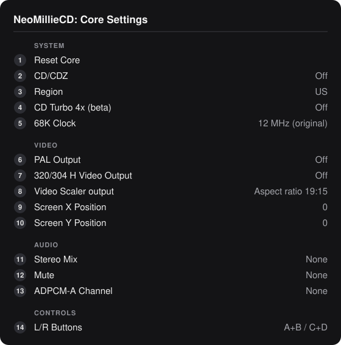

# Manuale utente di NeoMillie

[English](manual.md) | [Español](manual.es.md) | [Français](manual.fr.md) | [Deutsch](manual.de.md) | [Italiano](manual.it.md) | [日本語](manual.ja.md)

Per NeoMillie e NeoMillieCD 0.6.0 su Analogue Pocket.

NeoMillie è un core FPGA per Analogue Pocket, portato dall'RTL del Neo Geo del progetto MiSTer. Serve a giocare ai
giochi Neo Geo: con NeoMillie i giochi su cartuccia, come console domestica (AES) o come scheda arcade (MVS), e con
NeoMillieCD i dischi del Neo Geo CD. Entrambi sono core openFPGA. Nessuno dei due include BIOS, giochi o dischi: li
procuri tu.

I nomi delle impostazioni compaiono qui in inglese, così come li mostra il Pocket.

## Indice

1. [Cosa ti serve](#cosa-ti-serve)
2. [Avviare un gioco](#avviare-un-gioco)
3. [Comandi](#comandi)
4. [Il menu del core per cartucce](#il-menu-del-core-per-cartucce)
5. [Il menu del core CD](#il-menu-del-core-cd)
6. [Immagini del disco](#immagini-del-disco)
7. [Tempi di caricamento e velocità](#tempi-di-caricamento-e-velocità)
8. [Salvataggi](#salvataggi)
9. [Cose che un gioco fa e sembrano difetti](#cose-che-un-gioco-fa-e-sembrano-difetti)
10. [Quando qualcosa va storto](#quando-qualcosa-va-storto)

## Cosa ti serve

Scarica i due zip da [Releases](https://github.com/uniplexed/neomillie/releases) e decomprimili entrambi nella radice
della scheda SD, unendo le cartelle. Poi aggiungi i tuoi file.

Per i giochi su cartuccia, in `Assets/ng/common/`:

| File | Cos'è |
|---|---|
| `uni-bios_4_0.rom` | L'UniBIOS 4.0 |
| `000-lo.lo` | La ROM LO |
| `sfix.sfix` | Il livello di testo del BIOS |
| Una cartella per gioco | Le ROM del gioco con l'organizzazione Darksoft: `srom`, `prom`, `crom0`, `m1rom`, `vroma0`, e `prom1` se il gioco ce l'ha |

Ogni cartella di gioco deve avere il nome che la sua voce nell'elenco del core si aspetta. Se usi già il core Neo Geo
Overdrive, puoi usare qui il tuo BIOS e le tue cartelle dei giochi senza modifiche.

Per i dischi, in `Assets/ngcd/common/`:

| File | Cos'è |
|---|---|
| `uni-bioscd.rom` | L'UniBIOS CD, di esattamente 524.288 byte. Il core lo carica dal nome |
| `000-lo.lo` | La ROM LO |
| Una cartella per disco | Il `.cue` del disco con il suo `.bin` accanto, per esempio `Metal Slug/Metal Slug.cue` e `Metal Slug.bin` |

Un disco deve essere un CUE con un BIN. In [Immagini del disco](#immagini-del-disco) trovi come convertire gli altri
formati.

## Avviare un gioco

Core per cartucce: sul Pocket apri openFPGA, poi Neo Geo, e scegli un gioco dall'elenco. Il core carica il BIOS e le ROM
del gioco e lo avvia.

Core CD: apri openFPGA, poi Neo Geo CD, poi NeoMillieCD. Il BIOS si carica e mostra la propria schermata. Apri il menu del
Pocket, vai in Core Settings e scegli il `.cue` del disco nella voce Disc. Il BIOS trova il disco e lo avvia. Per cambiare
disco, scegli un altro `.cue` allo stesso modo.

Per uscire da un core, apri il menu del Pocket e scegli Quit. In quel momento il Pocket scrive anche i tuoi salvataggi
sulla scheda SD, quindi esci con Quit invece di spegnere il Pocket a metà partita.

## Comandi

| Pocket | Neo Geo |
|---|---|
| Croce direzionale | Joystick |
| A, B, X, Y | A, B, C, D |
| Start | Start |
| Select | Select sulla console domestica, e un gettone in modalità arcade |
| L | A e B insieme, oppure A, B e C insieme |
| R | C e D insieme, oppure A, B e C insieme |

Cosa fanno L e R lo scegli in [L/R Buttons](#lr-buttons). Un secondo controller collegato al Dock è il giocatore 2.

## Il menu del core per cartucce

Con un gioco in corso, apri il menu del Pocket e vai in Core Settings. Il Pocket elenca le voci del core in quest'ordine,
con la stessa numerazione usata in questa sezione. Sul Pocket è un'unica lista: i nomi dei gruppi compaiono solo
nell'immagine.

La maggior parte delle voci ha effetto subito. Tre riavviano il gioco quando le cambi: Reset Core, AES/MVS e 68K Clock.
Salva prima.

Il Pocket ricorda ogni voce per la volta successiva, tranne MVS DIP, Memory Card Unplugged, Mute e ADPCM-A Channel, che
tornano al valore predefinito ogni volta che apri il core.

### Sistema

1. Reset Core. Riavvia la console. Prima di farlo, il core scrive la memory card sulla scheda SD, e in modalità MVS anche
   la RAM di backup, così un reset non fa perdere nessun salvataggio.

2. AES/MVS. Con la voce attiva il core è la scheda arcade (MVS), con la voce disattivata è la console domestica (AES). Il
   valore predefinito è attivo. L'UniBIOS si adegua da solo a questa voce, quindi qui la voce SYSTEM del menu
   dell'UniBIOS non ha effetto. In modalità MVS Select inserisce un gettone e il gioco conserva impostazioni e record
   nella RAM di backup. Se la cambi, il gioco si riavvia.

3. Region (Reset to apply). Japan, USA o Europe, oppure From the BIOS, che lascia decidere all'impostazione dell'UniBIOS.
   From the BIOS è il valore predefinito. I giochi usano la regione per scegliere la lingua, e alcuni per mostrare o
   nascondere il sangue. La console legge la regione all'avvio, quindi dopo averla cambiata usa Reset Core. Funziona solo
   con l'UniBIOS.

4. MVS DIP. I DIP switch della scheda arcade. Settings apre il menu di test e impostazioni della scheda, Freeplay permette
   di giocare senza gettoni e Freeze ferma il gioco finché è attivo. L'elenco offre anche ogni coppia e tutte e tre
   insieme. Se Settings non ha effetto, lascialo attivo e usa Reset Core.

5. Memory Card Unplugged. Fa in modo che la console non veda alcuna memory card. Serve con i giochi che a ogni avvio
   chiedono della card, se la domanda ti dà fastidio.

6. 68K Clock. La velocità del processore principale della console: 12 MHz come l'originale, 16 MHz o 24 MHz. Un processore
   più veloce svolge più lavoro in ogni fotogramma, quindi le scene che rallentano su una console vera rallentano meno. Il
   gioco in sé non va più veloce, perché il suo ritmo segue i 60 fotogrammi al secondo dello schermo. Audio e tempi
   dell'immagine non cambiano. Se la cambi, il gioco si riavvia.

### Video

7. PAL Output. Fa girare l'immagine della console a 50 fotogrammi al secondo, lo standard PAL, come una console europea.
   Con la voce disattivata, il valore predefinito, sono 60. Con la voce attiva i giochi vanno un po' più lenti.
   L'immagine mantiene le sue 224 linee.

8. 320/304 H Video Output. Con la voce attiva vedi tutte le 320 colonne che la console disegna. Disattivata, il valore
   predefinito, mostra le 304 centrali e così nasconde le colonne ai bordi, dove molti giochi lasciano residui grafici.

9. Video Scaler output. La forma dell'immagine sullo schermo del Pocket: 19:15, 160:144, 4:3 o 16:9. Il valore
   predefinito è 19:15. L'opzione 16:9 è pensata per un televisore collegato al Dock.

10. Screen X Position. Sposta l'immagine a sinistra o a destra, da -32 a 32 pixel. Un numero positivo la sposta a destra.

11. Screen Y Position. Sposta l'immagine in alto o in basso, da -16 a 16 linee. Un numero positivo la sposta in basso.

### Audio

12. Stereo Mix. Miscela i canali sinistro e destro: None, 25%, 50% o 100%, che è mono. Alcuni giochi mettono un suono
    tutto su un lato, cosa faticosa in cuffia. Un po' di miscelazione lo attenua.

13. Mute. Silenzia una o più delle quattro sorgenti del chip audio: la musica FM, i campioni brevi (A), i campioni lunghi
    (B) e i canali a onda quadra (PSG). L'elenco contiene tutte le combinazioni.

14. ADPCM-A Channel. I campioni brevi suonano su sei canali. Questa voce ne silenzia uno, oppure ne fa suonare uno da solo
    (Solo).

Con Mute e ADPCM-A Channel puoi ascoltare come un gioco compone il suo audio. Per giocare, lasciali entrambi su None.

### Comandi

15. L/R Buttons. Stabilisce quali tasti premono i dorsali.

| Impostazione | L | R |
|---|---|---|
| A+B / C+D, il valore predefinito | A e B | C e D |
| ABC / C+D | A, B e C | C e D |
| A+B / ABC | A e B | A, B e C |

## Il menu del core CD

Il core CD non ha AES/MVS, Region (Reset to apply), MVS DIP né Memory Card Unplugged. In compenso ha tre voci proprie, in
cima. Le altre sono le stesse del core per cartucce e funzionano allo stesso modo.

Reset Core, CD/CDZ, CD Turbo 4x e 68K Clock riavviano il gioco. Dopo il riavvio il BIOS riparte e il disco resta
inserito. Il Pocket ricorda tutto tranne Mute e ADPCM-A Channel.

1. Reset Core. Riavvia la console, dopo aver scritto la memory card sulla scheda SD.

2. CD/CDZ. Sceglie quale console è il core. Con la voce disattivata, il valore predefinito, è il primo Neo Geo CD, che
   legge il disco a velocità singola. Con la voce attiva è il CDZ, che legge a velocità doppia e quindi carica in circa
   metà del tempo. L'UniBIOS si adegua da solo a questa voce. Se la cambi, il gioco si riavvia.

3. Region. US, EU, JP o AS (Asia). US è il valore predefinito. È la regione che dichiara la console stessa, e i giochi la
   usano come la Region del core per cartucce. Dopo averla cambiata usa Reset Core.

4. CD Turbo 4x (beta). Legge i dati del disco a quattro volte la velocità singola, con CD/CDZ attivo o no. La musica del
   disco continua a suonare a velocità normale. È provata solo con l'UniBIOS e su pochi dischi: se un gioco si comporta
   male con questa voce attiva, come prima cosa disattivala. Se la cambi, il gioco si riavvia.

5. 68K Clock. Come nel core per cartucce. Su un disco accorcia anche un po' i caricamenti, perché una parte del
   caricamento la svolge il processore stesso.

Le voci da 6 a 14 sono PAL Output, 320/304 H Video Output, Video Scaler output, Screen X Position, Screen Y Position, Stereo
Mix, Mute, ADPCM-A Channel e L/R Buttons, come descritto sopra. Con un disco ci sono due differenze: Stereo Mix miscela
anche la musica del disco, e Mute non la silenzia. La sorgente B di Mute non fa nulla, perché il Neo Geo CD non ha
campioni lunghi.

## Immagini del disco

Il core legge un disco come un `.cue` che rimanda a un solo `.bin`, con tracce di tipo `MODE1/2352` e `AUDIO`. Va bene
anche un `.bin` grezzo con una sola traccia dati.

Ogni altro formato lo converti prima con il NeoMillieCD Converter, allegato a ogni
[release](https://github.com/uniplexed/neomillie/releases). Il convertitore legge:

- un `.cue` con file BIN, ISO o WAV, uno per traccia o condivisi, audio big-endian (`MOTOROLA`), o audio MP3, OGG, FLAC,
  APE o Opus;
- CloneCD (`.ccd` con il suo `.img`), Alcohol 120% (`.mds` con il suo `.mdf`, versione 1), Nero (`.nrg`) e DiscJuggler
  (`.cdi`, versioni 2, 3 e 3.5);
- CHD (`.chd`).

Legge i tuoi file senza modificarli e scrive una cartella per disco con un CUE e un BIN. Scrive ogni disco con un nome
temporaneo e lo rinomina solo quando è completo, quindi un disco fallito o annullato non lascia nulla. Salta un disco già
presente nella destinazione, a meno che tu non chieda di sovrascriverlo. Rifiuta le tracce `MODE2` e i dischi con più di
una sessione, che i giochi Neo Geo CD non usano.

### La finestra

Scarica lo zip per il tuo sistema e decomprimilo:

| Sistema | File |
|---|---|
| Windows x64 | `NeoMillieCD-Converter-windows-x64.zip` |
| macOS su Apple Silicon | `NeoMillieCD-Converter-macos-arm64.zip` |
| Linux x64 | `NeoMillieCD-Converter-linux-x64.zip` |

Ogni programma è autonomo. È costruito con PyInstaller e contiene un proprio interprete Python, il toolkit Tcl/Tk che
disegna la finestra e le librerie che usa Python, come OpenSSL, zlib, bzip2 e xz. Quello per Linux contiene anche le
librerie X11, fontconfig e FreeType che servono alla finestra. Non serve installare nulla per usarlo, ed è per questo
che ogni zip pesa tra 10 e 25 MB, contro i 56 KB degli script. ffmpeg e chdman non sono inclusi: vedi [ffmpeg e
chdman](#ffmpeg-e-chdman). Le licenze di tutto ciò che contengono sono in `THIRD-PARTY-LICENSES.txt`, dentro ogni zip.

I programmi non sono firmati. La prima volta Windows SmartScreen chiede conferma: scegli *More info*, poi *Run anyway*.
Su macOS, apri l'app una volta, chiudi il messaggio che dice che non può essere verificata, poi in Impostazioni di
Sistema, Privacy e sicurezza, scegli *Open Anyway*. Per i Mac Intel non c'è una build: usa lo script qui sotto con
Python.

#### Passo per passo

1. Apri il programma. All'inizio la finestra è vuota.

   

2. Aggiungi i tuoi dischi. Con *Add discs…* scegli file immagine (`.cue`, `.chd`, `.ccd`, `.mds`, `.nrg`, `.cdi`); con
   *Add folder…* scegli una cartella e il convertitore trova tutti i dischi al suo interno e nelle sottocartelle. Ogni
   disco occupa una riga con nome, formato e stato. Il nome è quello che avranno la cartella e i file del disco sulla
   scheda SD: fai doppio clic per cambiarlo. *Remove* toglie dall'elenco le righe selezionate.
3. Scegli dove vanno i dischi con *Browse…*. Con *SD card layout* attivo, scegli la radice della scheda SD e ogni disco
   va in `Assets/ngcd/common/`, dove il core lo cerca. Con l'opzione disattivata, i dischi vanno nella cartella che
   scegli. Un disco già presente viene saltato, a meno che *Overwrite* non sia attivo.

   

4. Guarda la colonna dello stato. Un disco che indica *needs chdman* o *needs ffmpeg* aspetta quel programma: installalo
   (vedi [ffmpeg e chdman](#ffmpeg-e-chdman)) oppure premi *Locate…* accanto al nome del programma, sotto *Tools*, e sceglilo. Il disco passa a
   *pending*.

   

5. Premi *Convert*. La barra *Disc* segue il disco in conversione, e *Total* l'intero elenco. *Cancel* interrompe: il
   disco in conversione viene scartato del tutto, senza nulla scritto a metà, e i dischi già finiti restano.

   

6. Quando ogni riga indica *done*, i dischi sono pronti: una cartella per disco, ognuna con un `.cue` e un `.bin`.
   Inserisci la scheda SD nel Pocket e, in Core Settings del core CD, scegli il `.cue` del disco nella voce Disc. Se un
   disco non riesce, la sua riga ne indica il motivo; gli altri vengono convertiti comunque.

   

La finestra ricorda la destinazione, se *SD card layout* è attivo e dove si trovano ffmpeg e `chdman`.

### Lo script

`NeoMillieCD-Converter-python.zip` contiene lo stesso convertitore come script Python, per qualunque sistema con Python
3.8 o successivo:

    python cd_convert.py SOURCE... DEST [--name NAME] [--overwrite]
    python cd_convert_gui.py

SOURCE è un'immagine del disco o una cartella. Per la struttura del core, DEST è `<SD card>/Assets/ngcd/common`. Ogni
disco prende il nome dell'immagine fino alla prima parentesi, quindi `Metal Slug (1996)(SNK)(Jp-US)[!]` diventa
`Metal Slug`; `--name` lo imposta per un disco. Su Linux la finestra può richiedere il pacchetto `python3-tk` della
distribuzione.

### ffmpeg e chdman

Nessuno dei due è incluso nel convertitore. Il convertitore li cerca prima accanto a sé e poi nel PATH, e nella finestra puoi
indicarli con *Locate…*.

| Serve per | Windows | macOS | Debian e Ubuntu |
|---|---|---|---|
| Audio compresso: ffmpeg | `winget install Gyan.FFmpeg` | `brew install ffmpeg` | `sudo apt install ffmpeg` |
| CHD: chdman | `chdman.exe` da [MAME](https://www.mamedev.org/) | `brew install rom-tools` | `sudo apt install mame-tools` |

## Tempi di caricamento e velocità

Tre impostazioni cambiano il tempo che un disco impiega a caricarsi. La tabella riporta la somma di sette caricamenti di
The King of Fighters '99, cronometrati dal core stesso su un Pocket.

| CD/CDZ | CD Turbo 4x | 68K Clock | Sette caricamenti |
|---|---|---|---|
| Off | Off | 12 MHz | 66,3 s |
| On | Off | 12 MHz | 38,4 s |
| Off | On | 12 MHz | 27,8 s |
| On | On | 12 MHz | 27,8 s |
| On | On | 16 MHz | 24,5 s |
| On | On | 24 MHz | 23,6 s |

Per l'uso di tutti i giorni l'impostazione provata è CD/CDZ attivo. CD Turbo 4x fa risparmiare più tempo, ma è ancora in
beta. Il 68K Clock accorcia di poco i caricamenti; serve soprattutto contro i rallentamenti nelle scene affollate.

## Salvataggi

| Core | Salvataggio | File sulla scheda SD |
|---|---|---|
| Cartucce | Memory card, una per gioco | `Saves/ng/uniplexed.NeoMillie/`, col nome del gioco, `.sav` |
| Cartucce, modalità MVS | RAM di backup: le impostazioni della scheda, i record e la contabilità | `Saves/ng/common/backup.bak` |
| CD | Memory card, una per tutti i dischi | `Saves/ngcd/common/uni-bioscd.sav` |

Il Pocket scrive questi file quando scegli Quit, quando va in sospensione e quando lo spegni dal suo menu. Il core li scrive
anche con Reset Core. Fino ad allora, un salvataggio fatto nel gioco resta solo nella memoria della console.

I salvataggi del core Neo Geo Overdrive non si caricano in questo core, e non esiste un convertitore.

## Cose che un gioco fa e sembrano difetti

Fatal Fury 3 su CD oscura lo schermo per quasi un secondo subito dopo il primo "Fight" di un incontro, e di nuovo, per
meno tempo, alla fine di un round. Lo fa il gioco stesso: spegne l'immagine mentre il processore copia un quarto di
megabyte per sostituire le voci dello speaker con quelle dei combattenti. Una console vera impiega lo stesso tempo. Con il
68K Clock a 24 MHz la copia, e lo schermo nero, durano meno.

La voce SYSTEM dell'UniBIOS mostra un tipo di console e permette di cambiarlo. In questi core non ha effetto: per le
cartucce decide AES/MVS, per i dischi CD/CDZ.

Dopo aver cambiato AES/MVS, CD/CDZ, CD Turbo 4x o il 68K Clock il gioco si riavvia, perché è così che l'impostazione entra
in vigore.

## Quando qualcosa va storto

| Cosa vedi | Cosa controllare |
|---|---|
| Il BIOS CD dice che non c'è il disco | Il `.cue` nomina esattamente un `.bin`, nella stessa cartella e con la stessa grafia. Le sue tracce sono `MODE1/2352` o `AUDIO`. Un CUE con file `WAVE`, più righe `FILE` o `MODE1/2048` richiede il [convertitore](#immagini-del-disco) |
| Un disco smette di caricarsi o si comporta male con CD Turbo 4x attivo | Disattiva CD Turbo 4x e riprova |
| Un gioco su cartuccia non è nell'elenco, o non parte | La sua cartella in `Assets/ng/common/` ha il nome che l'elenco si aspetta, e contiene tutti i file indicati in [Cosa ti serve](#cosa-ti-serve) |
| Un salvataggio è sparito | Il core è stato lasciato senza Quit. Vedi [Salvataggi](#salvataggi) |
| Region non ha effetto su una cartuccia | Serve l'UniBIOS, e un Reset Core dopo la modifica |
| L'immagine è tagliata a sinistra o a destra | Attiva 320/304 H Video Output, oppure spostala con Screen X Position |

Per qualunque altra cosa, apri una segnalazione su [github.com/uniplexed/neomillie](https://github.com/uniplexed/neomillie/issues)
e indica core, versione, BIOS, gioco e impostazioni.

Come sono costruiti i core è spiegato in [architecture.md](architecture.md), in inglese.
