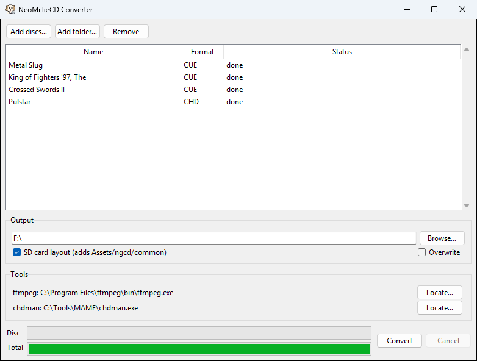

# NeoMillie user manual

[English](manual.md) | [Español](manual.es.md) | [Français](manual.fr.md) | [Deutsch](manual.de.md) | [Italiano](manual.it.md) | [日本語](manual.ja.md)

For NeoMillie and NeoMillieCD 0.6.0 on the Analogue Pocket.

NeoMillie runs Neo Geo cartridge games, in home console (AES) or arcade (MVS) mode. NeoMillieCD runs Neo Geo CD discs. Both
are openFPGA cores. Neither comes with a BIOS, a game or a disc: you supply your own.

## Contents

1. [What you need](#what-you-need)
2. [Starting a game](#starting-a-game)
3. [Controls](#controls)
4. [The menu of the cartridge core](#the-menu-of-the-cartridge-core)
5. [The menu of the CD core](#the-menu-of-the-cd-core)
6. [Disc images](#disc-images)
7. [Load times and speed](#load-times-and-speed)
8. [Saves](#saves)
9. [Things a game does that look like faults](#things-a-game-does-that-look-like-faults)
10. [When something goes wrong](#when-something-goes-wrong)

## What you need

Download the two zips from [Releases](https://github.com/uniplexed/neomillie/releases) and unzip each to the root of the
SD card, merging folders. Then add your own files.

For cartridge games, in `Assets/ng/common/`:

| File | What it is |
|---|---|
| `uni-bios_4_0.rom` | The UniBIOS 4.0 |
| `000-lo.lo` | The LO ROM |
| `sfix.sfix` | The BIOS's text layer |
| One folder per game | The game's ROMs in the Darksoft layout: `srom`, `prom`, `crom0`, `m1rom`, `vroma0`, and `prom1` if the game has one |

A game's folder has the name its entry in the core's list expects. If you already use the Neo Geo Overdrive core, your
BIOS and game folders work here as they are.

For discs, in `Assets/ngcd/common/`:

| File | What it is |
|---|---|
| `uni-bioscd.rom` | The UniBIOS CD, exactly 524,288 bytes. The core loads it by name |
| `000-lo.lo` | The LO ROM |
| One folder per disc | The disc's `.cue` with its `.bin` beside it, for example `Metal Slug/Metal Slug.cue` and `Metal Slug.bin` |

A disc has to be one CUE with one BIN. [Disc images](#disc-images) says how to convert the other formats.

## Starting a game

Cartridge core: on the Pocket open openFPGA, then Neo Geo, and pick a game from the list. The core loads the BIOS and the
game's ROMs and starts.

CD core: open openFPGA, then Neo Geo CD, then NeoMillieCD. The BIOS loads and shows its own screen. Open the Pocket's
menu, go to Core Settings and pick the disc's `.cue` on the Disc entry. The BIOS finds the disc and starts it. To change
discs, pick another `.cue` the same way.

To leave either core, open the Pocket's menu and choose Quit. That is also when the Pocket writes your saves to the SD
card, so leave with Quit instead of switching the Pocket off mid-game.

## Controls

| Pocket | Neo Geo |
|---|---|
| D-pad | Joystick |
| A, B, X, Y | A, B, C, D |
| Start | Start |
| Select | Select on the home console, and a coin in arcade mode |
| L | A and B together, or A, B and C together |
| R | C and D together, or A, B and C together |

What L and R do is set by [L/R Buttons](#lr-buttons). A second controller, through the Dock, is player 2.

## The menu of the cartridge core

With a game running, open the Pocket's menu and go to Core Settings. The Pocket lists the core's items in this order. The
numbers are the ones this section uses. The Pocket shows one plain list: the group names are only in this picture.

Most items take effect at once. Three restart the game when you change them: Reset Core, AES/MVS and 68K Clock. Save
first.

The Pocket remembers every item for the next time, except MVS DIP, Memory Card Unplugged, Mute and ADPCM-A Channel, which
go back to their defaults each time you open the core.

### System

1. Reset Core. Restarts the console. Before it does, the core writes the memory card to the SD card, and in MVS mode the
   backup RAM as well, so a reset does not lose a save.

2. AES/MVS. On is the arcade board (MVS), off is the home console (AES). On is the default. The UniBIOS follows this
   item by itself: the SYSTEM item in the UniBIOS's own menu has no effect here. In MVS mode Select inserts a coin and the
   game keeps its settings and high scores in the backup RAM. Changing it restarts the game.

3. Region (Reset to apply). Japan, USA or Europe, or From the BIOS to leave the choice to the UniBIOS's own setting.
   From the BIOS is the default. Games use the region to choose their language, and some to show or hide blood. The new
   region is read when the console starts, so use Reset Core after changing it. It works with the UniBIOS only.

4. MVS DIP. The arcade board's DIP switches. Settings opens the board's test and settings menu, Freeplay lets you play
   with no coins, and Freeze stops the game while it is on. The list also offers each pair and all three together. If
   Settings does nothing, use Reset Core with it on.

5. Memory Card Unplugged. Makes the console see no memory card. Use it for a game that asks about the card at every
   start when you do not want it to.

6. 68K Clock. The speed of the console's main processor: 12 MHz as the original, 16 MHz or 24 MHz. A faster processor
   gets more work done in each frame, so scenes that slow down on a real console slow down less. The game itself does
   not run faster, because its pace follows the screen's 60 frames a second. Sound and picture timing do not change.
   Changing it restarts the game.

### Video

7. PAL Output. Runs the console's picture at the PAL standard's 50 frames a second, as a European console did. Off, the
   default, is 60. Games run a little slower with it on. The picture keeps its 224 lines.

8. 320/304 H Video Output. On shows all 320 columns the console draws. Off, the default, shows the middle 304, which
   hides the columns at the edges where many games leave garbage.

9. Video Scaler output. The shape of the picture on the Pocket's screen: 19:15, 160:144, 4:3 or 16:9. The first is the
   default. The 16:9 choice is meant for a television through the Dock.

10. Screen X Position. Moves the picture left or right, from -32 to 32 pixels. A positive number moves it right.

11. Screen Y Position. Moves the picture up or down, from -16 to 16 lines. A positive number moves it down.

### Audio

12. Stereo Mix. Blends the left and right channels: None, 25%, 50% or 100%, which is mono. Some games put a sound hard
    on one side, which is tiring on headphones. A little mix softens that.

13. Mute. Silences one or more of the sound chip's four sources: FM music, the short samples (A), the long samples (B)
    and the square wave channels (PSG). The list has every combination.

14. ADPCM-A Channel. The short samples play on six channels. This item mutes one of them, or plays one alone (Solo).

Mute and ADPCM-A Channel are there for listening to how a game builds its sound. Leave both on None to play.

### Controls

15. L/R Buttons. What the shoulder buttons press.

| Setting | L | R |
|---|---|---|
| A+B / C+D, the default | A and B | C and D |
| ABC / C+D | A, B and C | C and D |
| A+B / ABC | A and B | A, B and C |

## The menu of the CD core

The CD core has no AES/MVS, Region (Reset to apply), MVS DIP or Memory Card Unplugged. It has three items of its own, at
the top. The rest are the same items as in the cartridge core and do the same.

Reset Core, CD/CDZ, CD Turbo 4x and 68K Clock restart the game. After a restart the BIOS starts again and the disc stays
in. The Pocket remembers everything except Mute and ADPCM-A Channel.

1. Reset Core. Restarts the console, after writing the memory card to the SD card.

2. CD/CDZ. Which console the core is. Off, the default, is the first Neo Geo CD, which reads the disc at single speed.
   On is the CDZ, which reads at double speed and so loads in about half the time. The UniBIOS follows this item by
   itself. Changing it restarts the game.

3. Region. US, EU, JP or AS (Asia). US is the default. It is the region the console itself reports, and games use it as
   the cartridge core's Region. Use Reset Core after changing it.

4. CD Turbo 4x (beta). Reads the disc's data at four times the single speed, with CD/CDZ on or off. Music from the
   disc still plays at normal speed. It is tested with the UniBIOS only, and on few discs: if a game misbehaves with it,
   turn it off first. Changing it restarts the game.

5. 68K Clock. As in the cartridge core. On a disc it also shortens the loads a little, as part of a load is the
   processor's own work.

Items 6 to 14 are PAL Output, 320/304 H Video Output, Video Scaler output, Screen X Position, Screen Y Position, Stereo
Mix, Mute, ADPCM-A Channel and L/R Buttons, as described above. Two things differ on a disc. Stereo Mix also blends the
disc's music. Mute does not silence the disc's music, and its B source does nothing, as the Neo Geo CD has no long
samples.

## Disc images

The core reads a disc as one `.cue` naming one `.bin`, with tracks of type `MODE1/2352` and `AUDIO`. A raw `.bin` of one
data track works too.

Every other form needs converting first with the NeoMillieCD Converter, attached to each
[release](https://github.com/uniplexed/neomillie/releases). It reads:

- a `.cue` with BIN, ISO or WAV files, one per track or shared, big-endian audio (`MOTOROLA`), or MP3, OGG, FLAC, APE or
  Opus audio;
- CloneCD (`.ccd` with its `.img`), Alcohol 120% (`.mds` with its `.mdf`, version 1), Nero (`.nrg`) and DiscJuggler
  (`.cdi`, versions 2, 3 and 3.5);
- CHD (`.chd`).

It reads your files without changing them and writes one folder per disc with one CUE and one BIN. A disc is written
under a temporary name and renamed only when complete, so a failed or cancelled disc leaves nothing behind. A disc
already at the destination is skipped unless you ask to overwrite it. It refuses `MODE2` tracks and discs with more than
one session, which Neo Geo CD games do not use.

### The window

Download the zip for your system and unzip it:

| System | File |
|---|---|
| Windows x64 | `NeoMillieCD-Converter-windows-x64.zip` |
| macOS on Apple Silicon | `NeoMillieCD-Converter-macos-arm64.zip` |
| Linux x64 | `NeoMillieCD-Converter-linux-x64.zip` |

The programs are not signed. The first time, Windows SmartScreen asks: choose *More info*, then *Run anyway*. On macOS,
open the app once, close the message that it cannot be checked, then in System Settings, Privacy & Security, choose
*Open Anyway*. There is no build for Intel Macs: use the script below with Python.

#### Step by step

1. Open the program. The window starts empty.

   

2. Add your discs. *Add discs…* picks image files (`.cue`, `.chd`, `.ccd`, `.mds`, `.nrg`, `.cdi`); *Add folder…*
   picks a folder and finds every disc in it and in its subfolders. Each disc gets a row with its name, its format and
   its status. The name is what the disc's folder and files will be called on the SD card: double-click it to change it.
   *Remove* takes the selected rows out of the list.
3. Pick where the discs go with *Browse…*. With *SD card layout* on, pick the root of the SD card and each disc goes to
   `Assets/ngcd/common/`, where the core looks for it. With it off, the discs go into the folder you pick. A disc
   already there is skipped, unless *Overwrite* is on.

   

4. Look at the status column. A disc that says *needs chdman* or *needs ffmpeg* waits for that program: install it
   (see [ffmpeg and chdman](#ffmpeg-and-chdman)) or press *Locate…* beside it and pick the program. The disc turns to
   *pending*.

   

5. Press *Convert*. The *Disc* bar follows the disc being converted, and *Total* the whole list. *Cancel* stops: the
   disc being converted is left out entirely, with nothing half written, and the discs already done stay.

   

6. When every row says *done*, the discs are ready: one folder per disc, each with one `.cue` and one `.bin`. Put the
   SD card in the Pocket and, in the CD core's Core Settings, pick the disc's `.cue` on the Disc entry. A disc that
   failed says why in its row; the others are converted anyway.

   

The window remembers the destination and where ffmpeg and `chdman` are.

### The script

`NeoMillieCD-Converter-python.zip` holds the same converter as Python scripts, for any system with Python 3.8 or newer:

    python cd_convert.py SOURCE... DEST [--name NAME] [--overwrite]
    python cd_convert_gui.py

SOURCE is a disc image or a folder. For the core's layout, DEST is `<SD card>/Assets/ngcd/common`. Each disc's name is
the image's name up to its first bracket, so `Metal Slug (1996)(SNK)(Jp-US)[!]` becomes `Metal Slug`; `--name` sets
it for one disc. On Linux the window may need the distribution's `python3-tk`.

### ffmpeg and chdman

Neither comes with the converter. It finds each on the PATH or beside the converter, and the window has *Locate* for
them.

| Needed for | Windows | macOS | Debian and Ubuntu |
|---|---|---|---|
| Compressed audio: ffmpeg | `winget install Gyan.FFmpeg` | `brew install ffmpeg` | `sudo apt install ffmpeg` |
| CHD: chdman | `chdman.exe` from [MAME](https://www.mamedev.org/) | `brew install rom-tools` | `sudo apt install mame-tools` |

## Load times and speed

Three settings change how long a disc takes to load. These are seven loads of The King of Fighters '99 added up, timed
by the core itself on one Pocket.

| CD/CDZ | CD Turbo 4x | 68K Clock | Seven loads |
|---|---|---|---|
| Off | Off | 12 MHz | 66.3 s |
| On | Off | 12 MHz | 38.4 s |
| Off | On | 12 MHz | 27.8 s |
| On | On | 12 MHz | 27.8 s |
| On | On | 16 MHz | 24.5 s |
| On | On | 24 MHz | 23.6 s |

CD/CDZ on is the tested setting for everyday use. CD Turbo 4x gives the largest gain and is still in beta. The 68K
Clock helps loads only a little: its real use is the slowdown in busy scenes.

## Saves

| Core | Save | File on the SD card |
|---|---|---|
| Cartridge | Memory card, one for each game | `Saves/ng/uniplexed.NeoMillie/`, named after the game, `.sav` |
| Cartridge, MVS mode | Backup RAM: the board's settings, high scores and bookkeeping | `Saves/ng/common/backup.bak` |
| CD | Memory card, one for all discs | `Saves/ngcd/common/uni-bioscd.sav` |

The Pocket writes these files when you choose Quit, when it goes to sleep and when you switch it off from its menu. The
core also writes them on Reset Core. A save made in a game is in the console's memory until one of those happens.

Saves from the Neo Geo Overdrive core do not load in this one, and there is no converter.

## Things a game does that look like faults

Fatal Fury 3 on CD blacks the screen for most of a second right after the first "Fight" of a match, and again for a
shorter time when a round ends. The game does this itself: it switches the picture off while it swaps the announcer's
voices for the fighters', a quarter of a megabyte copied by the processor. A real console spends the same time. With the
68K Clock at 24 MHz the copy, and the black screen, are shorter.

The UniBIOS's SYSTEM item shows a console type and lets you change it. In these cores it has no effect. AES/MVS decides
on cartridges and CD/CDZ on discs.

After you change AES/MVS, CD/CDZ, CD Turbo 4x or the 68K Clock the game restarts. That is the setting taking effect.

## When something goes wrong

| What you see | What to check |
|---|---|
| The CD BIOS says there is no disc | The `.cue` names exactly one `.bin`, in the same folder and with the same spelling. Its tracks are `MODE1/2352` or `AUDIO`. A CUE with `WAVE` files, several `FILE` lines or `MODE1/2048` needs the [converter](#disc-images) |
| A disc stops loading or misbehaves with CD Turbo 4x on | Turn CD Turbo 4x off and try again |
| A cartridge game is not in the list, or does not start | Its folder in `Assets/ng/common/` has the name the list expects, and holds every file named in [What you need](#what-you-need) |
| A save is gone | The core was left without Quit. See [Saves](#saves) |
| Region has no effect on a cartridge | It needs the UniBIOS, and a Reset Core after the change |
| The picture is cut at the left or right | Turn 320/304 H Video Output on, or move it with Screen X Position |

For anything else, open an issue at [github.com/uniplexed/neomillie](https://github.com/uniplexed/neomillie/issues) and
say which core, version, BIOS, game and settings.

How the cores are built is in [architecture.md](architecture.md).
