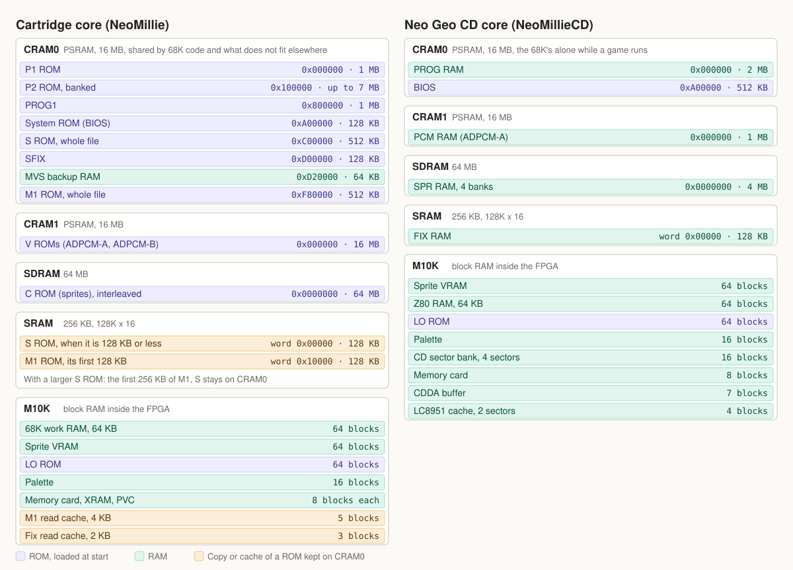

# Memory on the Analogue Pocket

How NeoMillie (cartridges) and NeoMillieCD (Neo Geo CD) use the Pocket's memories, and the timing numbers behind them.
Everything here comes from the RTL in this repository: `rtl/pocket/mem_map.svh` for the addresses,
`rtl/pocket/pocket_mem_mux.sv` for who gets each chip, and the three controllers named below.

## The chips

| Name | Part | Size | Bus | Controller | Clock |
|---|---|---|---|---|---|
| CRAM0, CRAM1 | AS1C8M16PL-70BIN PSRAM, run asynchronously | 16 MB each, two 4M x 16 dies | 16 bits, address multiplexed on DQ | `rtl/pocket/cram_ctrl.sv` | CLK_96M |
| SDRAM | AS4C32M16MSA-6BIN, CL3 | 64 MB | 16 bits, bursts of 4 | `rtl/pocket/sdram_ctrl.sv` | CLK_96M |
| SRAM | AS6C2016-55BIN | 256 KB, 128K x 16 | 16 bits, asynchronous, 55 ns | `rtl/pocket/sram_port.sv` | CLK_48M |
| M10K | Cyclone V 5CEBA4F23C8 block RAM | 308 blocks, of which the build allows 292 | | | |

`CLK_96M` has a shortest period T of 10.34 ns in AES mode (96.671 MHz) and 10.417 ns in MVS mode (96.000 MHz). `CLK_48M`
comes from the same PLL at phase 0, so a crossing between the two needs no synchroniser.

## Why each thing is where it is

- Sprites are the heaviest stream, 64 bits per PCK1, so they get the SDRAM's bursts alone.
- Samples get CRAM1 alone.
- 68K code goes on CRAM0. Each 68K read that finds the chip busy costs one wait state, so the layout keeps other readers off it.
- The fix layer is read every PCK2 and has a hard deadline. It goes to the SRAM whenever it fits.
- A Neo Geo CD's Z80 program is 64 KB of RAM and fits in M10K. A cartridge's is a ROM of up to 512 KB, which is why the cart core
  splits it.

## The cartridge core's split

The S and M1 files stay whole on CRAM0. After a load, a copy engine in the mux moves part of them to the SRAM. The split depends
only on the size of the S file, seen in the loader's stream, so games need no setting:

| S ROM | SRAM words 0x00000-0x0FFFF | SRAM words 0x10000-0x1FFFF | On CRAM0 while playing |
|---|---|---|---|
| Up to 128 KB | S ROM | First 128 KB of M1 | M1 above 128 KB |
| Larger | First 128 KB of M1 | Next 128 KB of M1 | S ROM, M1 above 256 KB |

SFIX is always on CRAM0. What is read from CRAM0 for the fix and the Z80 goes through two direct-mapped read caches, both emptied
by a reset: 2K words of M1, tagged by `m1_addr[18:12]`, and 1K words of fix, tagged by `{nSYSTEM_G, FIX_BANK, tile[11:6]}`.

A write to S or M1 by the loader marks the copy dirty. It runs when the loader has finished, restarts if another write arrives, and
holds the core in reset through `ROM_COPY_BUSY`. The whole SRAM takes 131,072 words at about 34 clocks each, about 46 ms.

MVS backup RAM is in CRAM0 at 0xD20000. A 68K read waits like a ROM read. A write is posted in one entry and needs no wait: the next
one is at least 32 clocks later, and the entry leaves as soon as CRAM0 takes it. The bridge reaches it through `bk_req`, `bk_ack`.

## Who gets each chip

Fixed priority, highest first. A request stays pending until it is served.

| Chip | Cart core | CD core |
|---|---|---|
| CRAM0 | Loader, save path, posted backup write, 68K, fix if on CRAM0, Z80 if on CRAM0, S and M1 copy | Loader, 68K, CD write queue |
| CRAM1 | Loader, ADPCM-A, ADPCM-B | Loader, CD write queue, ADPCM-A, ADPCM-B |
| SDRAM | Sprite, loader, with refresh spaced by a watchdog | Sprite, CD read, loader, CD write queue, with refresh |
| SRAM | Fix, copy write, Z80 | Fix, CD read, CD write |

A Z80 read starts only within `Z80_WINDOW` (53 clocks) of PCK2's fall, so none is in flight when the next fix read lands.

## Video deadlines

In clocks of CLK_96M, measured on MiSTer's RTL by `sim/lspc_timing`:

| Event | Clocks |
|---|---|
| PCK1 and PCK2 period, each | 64, falling 32 apart |
| `neo_b1` samples the fix, from PCK2's fall | 24, so the data must be visible at 23: `FIX_DEADLINE` |
| `zmc2_dot` loads the sprite data, from PCK1's fall | 28, so the data must be visible at 27: `SPR_DEADLINE` |

An SRAM fix read takes 13 or 14 clocks from PCK2's fall.

## RD_WAIT

`RD_WAIT` is the number of `CLK_96M` clocks from the fall of CE# and ADV# to the clock that samples a PSRAM read. It is a parameter
of `cram_ctrl`, and applies to both CRAM0 and CRAM1. The release value is 8.

A read, with E*n* the clock edge *n* clocks after CE# and ADV# fall:

| Edge | What happens |
|---|---|
| E0 | CE#, ADV#, UB#, LB# low, address on A and DQ |
| E1 | ADV# high |
| E2 | DQ released |
| E3 | OE# low |
| E`RD_WAIT` | Data sampled, CE#, OE#, UB#, LB# high, ack |

The next access can start 2 clocks after ack rises. Two accesses that change the direction of DQ also have `TURN` idle clocks between them.
A write holds WE# for `WR_WAIT` clocks, 6 in the release: E0 to the end of the write is 7 clocks, 72.38 ns against the chip's 70 ns
plus 2 ns of pad skew.

### The budget

The sample must come after the chip's tAA of 70 ns plus 11.22 ns of pads and board flight. Those 11.22 ns are the output window of
`synth/neogeo/pocket.sdc` (8.71 ns), its input window (1.71 ns) and 0.8 ns assumed for the board, for which there is no data.

| `RD_WAIT` | Time at T = 10.34 ns | Against 81.22 ns | Memory test, one Pocket at room temperature |
|---|---|---|---|
| 8 | 82.72 ns | 1.50 ns spare | 0 errors, 786 s, 29 loops |
| 7 | 72.38 ns | 8.84 ns short | 0 errors, 1200 s, 45 loops |
| 6 | 62.04 ns | 19.18 ns short | 0 errors, 1933 s, 75 loops |

The minimum the controller accepts is 4, or OE# is never low. Static timing checks the delay from registers to pads, not the chip, so a
met timing report says nothing about whether a lower value reads correctly.

The release stays at 8 because it is the only value inside the data sheet, and lowering it did not help. On the wait counter, Metal Slug X, first
mission, one play each, with the layout before the split above: `RD_WAIT` 8 lost 2.019% of the 68K's clocks and 7 lost 2.068%. One play of each cannot separate
a difference that small.

Raising it costs two clocks per pair of accesses against the fix deadline, as the fix may have to wait for one access already in flight.
Worst case seen on the memory test at `RD_WAIT` 8: 21 clocks of the 23.

### Changing it

Each build target sets it in its `.qsf`:

    set_global_assignment -name VERILOG_MACRO "NEOGEO_RD_WAIT=8"

`synth/neogeo` and `synth/neogeocd` are the releases, `neogeo_debug` and `neogeocd_debug` their debug builds, and `memtest` the memory self-test. To simulate another value, set `SIM_DEFINES`, and lower the chip model's access time to match, or the model will report the read as too early:

    SIM_DEFINES='+define+NEOGEO_RD_WAIT=7 +define+PSRAM_T_ACC=60' python tools/sim.py top

`READY_COMB` gives the 68K its PSRAM data a clock sooner, in the ack clock. All the builds set it.

## SRAM timing

`sram_port` launches every pin from a `CLK_48M` register, in the windows of `pocket.sdc`.

| Parameter | Value | Meaning |
|---|---|---|
| `RD_CLKS` | 5 | Clocks from address and OE# to sampling. STA meets it at 4, one more covers the board's unknowns |
| `RELEASE_CLKS` | 3 | Clocks for the chip to release DQ when a write follows a read |
| `WE_CLKS` | 3 | Clocks of WE# low, 62 ns against tWP 45 ns plus 2 ns of skew |

## Saves

| File | Where it lives | Size |
|---|---|---|
| Memory card, both cores | M10K, 8 blocks, second port on the bridge | 8 KB |
| MVS backup RAM, cart core | CRAM0 | 64 KB |

The bridge accesses them at 0x6xxxxxxx and 0x7xxxxxxx, two 16-bit accesses per 32-bit word. The host leaves 1.18 µs between words, and the word
of address N comes back in the read of N + 1. Both are in `rtl/pocket/apf_loader.sv`.

In `data.json`, a card that takes its name from slot 0 (`parameters` bit 2) is written on Quit only when slot 0 has no fixed `filename`.
The cart core picks the game in slot 0, so its card has one file per game. The CD core's slot 0 is the BIOS, so its card has a fixed name.

## Measuring

The 68K wait counter counts the clocks the 68K loses waiting for CRAM0, and writes them to `wait.sav` in the debug cores. `neogeo_debug` is the cart build and `neogeocd_debug`
the CD build.

    python tools/build.py neogeo_debug
    python tools/check_wait_save.py wait.sav

Benches, each `python tools/sim.py <name>`: `mem` the mux and the layouts against models of the chips, `apf` the loader and saves, `top` and `topcd` each core whole, `contention` an estimate of the waits for each layout, from a model of the traffic, always passing.

---

NeoMillie is free. If it is useful to you, [donate with PayPal](https://www.paypal.com/donate/?hosted_button_id=A72RAVHX98628).
